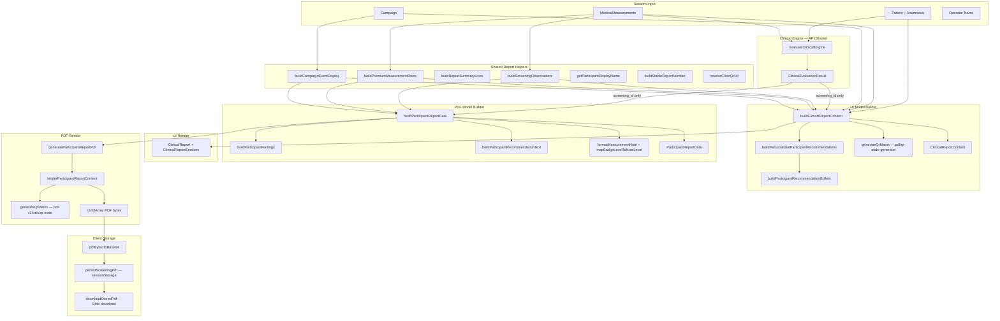

# MedScreen Festival — Architecture Audit (STEP 1)

> **Generated:** Architecture review based on verified codebase inspection  
> **Scope:** Audit only — no code changes, no fixes proposed as implementation  
> **Reference:** Builds on [`FILE_MAP.md`](./FILE_MAP.md)

---

## Executive Summary

The participant report does **not** have a single canonical model. The application maintains **two parallel content pipelines** that share some low-level helpers but diverge on findings presentation, recommendations, section structure, and branding assets. A third system — the **clinical engine** — produces operator-facing evaluation data that is **largely disconnected** from the participant report content.

The comment in `clinical-report-content.ts` claiming a "single source of truth" is **incorrect** relative to actual PDF generation behavior.

---

## 1. Single Source of Truth

### 1.1 Verdict: **NO — multiple models exist**

| Model | Location | Purpose |
|-------|----------|---------|
| `ClinicalReportInput` | `packages/shared/src/report/clinical-report-content.ts:51–77` | Shared input shape for both builders |
| `ClinicalReportContent` | `packages/shared/src/report/clinical-report-content.ts:81–129` | UI report model |
| `ParticipantReportData` | `packages/shared/src/pdf-v2/types/participant-report.types.ts:43–54` | PDF-v2 model (explicitly "decoupled from the legacy PDF renderer") |
| `ClinicalEvaluationResult` | `packages/types/src/clinical.ts:42–53` | Clinical engine output — operator results; only `screening_id` used in report builders |

There is **no single canonical participant report model**. PDF-v2 types explicitly state decoupling:

```1:1:packages/shared/src/pdf-v2/types/participant-report.types.ts
/** Data model for PDF v2 — decoupled from the legacy PDF renderer. */
```

The UI model comment claims unity but PDF uses a separate builder:

```133:135:packages/shared/src/report/clinical-report-content.ts
/** Single source of truth for on-screen report and PDF layout. */
export function buildClinicalReportContent(input: ClinicalReportInput): ClinicalReportContent {
```

Production PDF generation **does not consume** `ClinicalReportContent` for rendering. It only uses it for filename and `screening_id`:

```69:73:apps/web/src/features/screening/report/hooks/useGenerateReportPdf.ts
      const content = buildClinicalReportContent(input);
      const reportData = buildParticipantReportData(input);
      const bytes = generateParticipantReportPdf(reportData);
```

`generateParticipantReportPdf(reportData)` receives `ParticipantReportData`, not `ClinicalReportContent`.

---

### 1.2 Every place report content is **generated**

| # | Function | File | Output model | Used by |
|---|----------|------|--------------|---------|
| 1 | `buildClinicalReportContent()` | `report/clinical-report-content.ts:135` | `ClinicalReportContent` | UI (`ClinicalReport.tsx:83`), PDF hook (metadata only) |
| 2 | `buildParticipantReportData()` | `pdf-v2/build-participant-report-data.ts:21` | `ParticipantReportData` | PDF generation (`useGenerateReportPdf.ts:71`) |
| 3 | `buildPersonalizedParticipantRecommendations()` | `report/participant-recommendations.ts:187` | `ClinicalRecommendation[]` | UI path only (via `buildClinicalReportContent`) |
| 4 | `buildParticipantRecommendationBullets()` | `report/report-recommendation-bullets.ts:35` | `string[]` | UI path only |
| 5 | `buildParticipantRecommendationText()` | `pdf-v2/mappers/participant-report-mappers.ts:37` | `string` | PDF path only |
| 6 | `buildScreeningObservations()` | `report/report-screening-observations.ts:39` | `string[]` (internal keys) | Both builders (shared) |
| 7 | `buildParticipantFindings()` | `pdf-v2/mappers/participant-report-mappers.ts:18` | `string[]` (patient-friendly) | PDF path only |
| 8 | `buildPremiumMeasurementRows()` | `report/report-measurement-interpretation.ts:231` | `PremiumMeasurementRow[]` | Both builders (shared origin) |
| 9 | `buildReportSummaryLines()` | `report/report-summary.ts:2` | `string[]` | Both builders (shared function, different trigger — see §2) |
| 10 | `evaluateClinicalEngine()` | `clinical/engine.ts:57` | `ClinicalEvaluationResult` | Operator results page/API — **not** participant report body |

Clinical engine recommendations are **not** wired into participant report generation. `buildPersonalizedParticipantRecommendations` documents this explicitly:

```184:186:packages/shared/src/report/participant-recommendations.ts
 * Builds participant-facing recommendations from screening data.
 * Does not use generic engine recommendations — only data-supported guidance.
```

`buildClinicalReportContent` uses `evaluation` only for identifiers:

```101:107:packages/shared/src/report/clinical-report-content.ts
    reportNumber: buildStableReportNumber(input.evaluation.screening_id, input.screeningDate),
    ...
    screeningId: input.evaluation.screening_id,
```

No reference to `input.evaluation.recommendations`, `warnings`, or `risks` in that file (verified via grep).

---

### 1.3 Every place report content is **transformed**

| Transformation | File | Input → Output |
|----------------|------|----------------|
| Observations → findings (patient-friendly) | `participant-report-mappers.ts:18–34` | `string[]` → `string[]` |
| Observations → summary trigger | `build-participant-report-data.ts:60` vs `clinical-report-content.ts:185` | Different boolean inputs |
| `PremiumMeasurementRow` → `ParticipantReportMeasurement` | `build-participant-report-data.ts:61–67` | Adds `formatMeasurementNote()`, `mapBadgeLevelToNoteLevel()` |
| `ClinicalRecommendation[]` → bullets | `report-recommendation-bullets.ts:35–52` | Code-mapped short bullets |
| Findings count → paragraph | `participant-report-mappers.ts:37–42` | Binary generic text |
| Campaign → event display | `campaign-display.ts:46` | Used by both builders (shared) |
| Participant name | `report-personalization.ts` via `getParticipantDisplayName()` | Shared |
| QR URL | `pdf/qr-code-generator.ts:284` `resolveClinicQrUrl()` | Shared |
| QR matrix | `pdf/qr-code-generator.ts:301` (UI) / `pdf-v2/utils/qr-code.ts:265` (PDF) | **Duplicate generators** |
| Base64 encoding | `pdf-v2/stored-pdf-validation.ts:10` | Post-generation storage |

---

### 1.4 Every place report content is **rendered**

| Surface | Renderer | File | Input model |
|---------|----------|------|-------------|
| Web UI | React components | `ClinicalReport.tsx:113–143` | `ClinicalReportContent` |
| Web UI sections | Section components | `ClinicalReportSections.tsx` | Partial fields from content |
| PDF v2 | Canvas layout | `render-participant-report.ts:21–216` | `ParticipantReportData` |
| PDF legacy | `PdfDocumentBuilder` | `pdf/clinical-report-pdf.ts:16` | `ClinicalReportContent` — **not used in production app** |

UI render mapping (`ClinicalReport.tsx:117–141`):

```117:141:apps/web/src/features/screening/report/components/ClinicalReport.tsx
      <ClinicalReportClinicHeader content={content} />
      <ClinicalReportParticipantSection content={content} />
      <ClinicalReportSummary lines={content.summaryLines} />
      <ClinicalReportMeasurements rows={content.measurementRows} />
      <ClinicalReportScreeningObservations observations={content.screeningObservations} />
      <ClinicalReportRecommendations
        intro={content.recommendationsIntro}
        bullets={content.recommendationBullets}
      />
      {content.showBloodPressureEducation ? (
        <ClinicalReportBloodPressureEducation education={content.bloodPressureEducation} />
      ) : null}
      <ClinicalReportDisclaimer content={content} />
```

PDF render sections (`render-participant-report.ts`): Header → Title → Participant → Rezumat → Măsurători → Findings → Recomandări → Footer. No blood pressure education block exists in this file (verified: sections 1–8 only, lines 32–216).

---

## 2. UI vs PDF — Complete Comparison

### 2.1 Section-by-section table

| Section | UI | PDF | Status | Evidence |
|---------|----|----|--------|----------|
| **Clinic header — name** | Shown prominently | **Not in header**; only in footer | **Different / missing in PDF header** | UI: `ClinicalReportSections.tsx:145`; PDF header: `render-participant-report.ts:37–42` (slogan, phone, address, website only) |
| **Clinic header — slogan** | Shown | Shown | **Identical source** | Both from `CLINIC_BRANDING.slogan` via builders |
| **Clinic header — phone** | `"Telefon: {phone}"` | `"Telefon {phone}"` | **Different formatting** | UI: `ClinicalReportSections.tsx:149`; PDF: `render-participant-report.ts:39` |
| **Clinic header — address** | Shown | Shown | **Identical source** | `CLINIC_BRANDING.address` |
| **Clinic header — website** | Shown | Shown | **Identical source** | `CLINIC_BRANDING.website` |
| **Clinic header — email** | In `CLINIC_BRANDING` but **not rendered** | Not rendered | **Missing both** | `clinic-branding.ts:11` — no render reference |
| **Logo** | `/clinic-logo.svg` static asset | Embedded JPEG via `embedded-clinic-logo.ts` | **Different asset, different format** | UI: `ClinicalReportSections.tsx:133–141`; PDF: `generate-participant-report-pdf.ts:15`, `logo-loader.ts:3` |
| **QR code** | Precomputed `content.qrMatrix` (SVG) | Generated at render from `data.qrUrl` | **Duplicated generator, same URL source** | UI: `clinical-report-content.ts:205`, `ClinicalReportSections.tsx:171`; PDF: `render-participant-report.ts:63–64`, `pdf-v2/utils/qr-code.ts` |
| **Report title** | `RAPORT DE SCREENING MEDICAL` | Same string | **Identical** | `clinical-report-content.ts:183`; `build-participant-report-data.ts:51` |
| **Campaign / event block** | Below header, centered lines | In header area, left column | **Different layout** | UI: `ClinicalReportSections.tsx:187–212`; PDF: `render-participant-report.ts:44–61` |
| **Participant name** | `participantDisplayName` | `participant.displayName` | **Identical source** | Same `getParticipantDisplayName()` call in both builders |
| **Age** | Shown | Shown | **Identical** | Both from `input.participant.age` |
| **Screening date/time** | Shown | Shown | **Identical source** | Both via `formatScreeningDateTime()` |
| **Operator** | Shown in participant section | **Not in participant section**; in footer only | **Different placement** | UI: `ClinicalReportSections.tsx:231`; PDF participant: `render-participant-report.ts:96–100`; PDF footer: `render-participant-report.ts:208–212` |
| **Report number** | Shown | Shown (`Nr. raport`) | **Identical source** | `buildStableReportNumber()` in both builders |
| **Rezumat (summary)** | 2 lines from `buildReportSummaryLines()` | Same function, max 4 lines sliced | **Mostly identical text**; PDF slices to 4 | UI: `ClinicalReportSections.tsx:274–299`; PDF: `render-participant-report.ts:104–108`; shared: `report-summary.ts:2–14` |
| **Summary trigger** | `screeningObservations.length > 0` | `findings.length > 0` | **Different boolean** (usually equivalent) | `clinical-report-content.ts:185`; `build-participant-report-data.ts:60` |
| **Măsurători table** | 4 columns: Parametru, Rezultat, Valori recomandate, **Interpretare** | 4 columns: Parametru, Rezultat, Interval normal, **Observații** | **Different column labels** | UI: `ClinicalReportSections.tsx:321–327`; PDF: `render-participant-report.ts:114` |
| **Measurement row data** | `PremiumMeasurementRow[]` direct | Remapped via `formatMeasurementNote()` | **Transformed for PDF** | UI: `ClinicalReport.tsx:123`; PDF: `build-participant-report-data.ts:61–67` |
| **Measurement badges** | Tailwind pill from `interpretation` + `badgeLevel` | PDF badge from `notes` + `noteLevel` | **Different visual system** | UI: `ClinicalReportSections.tsx:91–113`; PDF: `render-participant-report.ts:153` |
| **Interpretation labels** | Raw: "Normală", "Crescută", etc. | Mapped: "Normal", "Peste interval", "Supraponderal" | **Transformed** | `formatMeasurementNote()` in `participant-report-mappers.ts:51–57` |
| **Findings / observations section** | Title: **"Observațiile screeningului"** | Title: **"Ce a identificat screeningul"** | **Different title** | UI: `ClinicalReportSections.tsx:379`; PDF: `render-participant-report.ts:165` |
| **Findings content** | Raw `screeningObservations` strings | Mapped `findings` strings | **Different content** | UI: `ClinicalReport.tsx:125`; PDF: `build-participant-report-data.ts:35`, `render-participant-report.ts:166–168` |
| **Respiratory symptoms** | Listed separately (dyspnea, snoring) | Merged to "Simptome respiratorii raportate" | **Transformed in PDF only** | `participant-report-mappers.ts:15–31` |
| **Recommendations section** | Intro + **bullet list** | **Single paragraph** in card | **Different structure and content** | UI: `ClinicalReportSections.tsx:411–459`; PDF: `render-participant-report.ts:172–187` |
| **Recommendations visibility** | Hidden if `bullets.length === 0` | Always rendered | **Different** | `ClinicalReportSections.tsx:425` |
| **Recommendations source** | `buildPersonalizedParticipantRecommendations` → bullets | `buildParticipantRecommendationText(findingsCount)` | **Completely different engines** | See §3 |
| **Blood pressure education** | Conditional section | **Missing entirely** | **Missing in PDF** | UI: `ClinicalReport.tsx:135–139`; absent from `render-participant-report.ts` |
| **Disclaimer / footer** | From `CLINICAL_REPORT_DISCLAIMER` + operator | Hardcoded same two sentences + operator | **Duplicated text source** | UI: `ClinicalReportSections.tsx:504–527`, `clinic-branding.ts:45–55`; PDF: `render-participant-report.ts:193–214` (hardcoded, not imported from `CLINICAL_REPORT_DISCLAIMER`) |
| **Filename** | N/A (download uses stored) | From `buildClinicalReportFilename(content)` | Uses UI model metadata | `useGenerateReportPdf.ts:79` |

---

### 2.2 Summary counts

| Category | Count |
|----------|-------|
| Identical (same source + same presentation) | 6 |
| Different (same data, different presentation) | 12 |
| Duplicated (logic/assets replicated) | 5 |
| Missing (present in one surface only) | 4 |
| Transformed (explicit mapper between surfaces) | 6 |

---

## 3. Recommendation Engine

### 3.1 Three separate recommendation systems exist

| System | Origin | Output | Used in participant report? |
|--------|--------|--------|----------------------------|
| **A. Clinical engine** | `clinical/engine.ts:37` → `buildRecommendations()` | `ClinicalEvaluationResult.recommendations` | **NO** — operator results only |
| **B. Personalized participant** | `participant-recommendations.ts:187` | `ClinicalRecommendation[]` with full messages | **UI only** |
| **C. PDF simplified text** | `participant-report-mappers.ts:37` | Single paragraph string | **PDF only** |

### 3.2 UI recommendation flow (verified)

```
buildClinicalReportContent()
  → buildPersonalizedParticipantRecommendations()     [participant-recommendations.ts:165-173]
  → buildParticipantRecommendationBullets()           [clinical-report-content.ts:221]
  → ClinicalReportRecommendations (intro + bullets)     [ClinicalReport.tsx:127-131]
```

Intro constant:

```3:4:packages/shared/src/report/report-recommendation-bullets.ts
export const PARTICIPANT_RECOMMENDATIONS_INTRO =
  'Pe baza informațiilor și măsurătorilor efectuate vă recomandăm:';
```

Bullets are code-mapped short phrases (e.g. `'consult cardiologic'`), not full recommendation messages:

```6:27:packages/shared/src/report/report-recommendation-bullets.ts
const BULLETS_BY_CODE: Record<string, string[]> = {
  chest_pain_evaluation: ['consult cardiologic'],
  ...
};
```

### 3.3 PDF recommendation flow (verified)

```
buildParticipantReportData()
  → buildParticipantFindings(screeningObservations)
  → buildParticipantRecommendationText(findings.length)   [build-participant-report-data.ts:69-70]
  → renderParticipantReportContent() recommendation card    [render-participant-report.ts:172-187]
```

PDF text is binary (findings vs no findings):

```37:42:packages/shared/src/pdf-v2/mappers/participant-report-mappers.ts
export function buildParticipantRecommendationText(findingsCount: number): string {
  if (findingsCount === 0) {
    return 'Pe baza informațiilor și măsurătorilor efectuate în cadrul screeningului, valorile actuale nu indică anomalii importante...';
  }
  return 'Pe baza informațiilor și măsurătorilor efectuate în cadrul screeningului, vă recomandăm o evaluare medicală de specialitate...';
}
```

### 3.4 Does PDF use the same recommendation model as UI?

**NO.**

| Aspect | UI | PDF |
|--------|----|----|
| Data type | `string[]` bullets + intro | `{ recommendationText: string }` |
| Generator | `buildPersonalizedParticipantRecommendations` + `buildParticipantRecommendationBullets` | `buildParticipantRecommendationText` |
| Granularity | Per-condition specialist bullets | One of two generic paragraphs |
| Uses clinical engine | No | No |
| Shares mapper | No | No |

The PDF model type confirms single-paragraph design:

```37:40:packages/shared/src/pdf-v2/types/participant-report.types.ts
/** One clear next step — no specialist list. */
export interface ParticipantReportRecommendations {
  recommendationText: string;
}
```

---

## 4. Findings

### 4.1 Where findings are produced

**Step 1 — Observations (shared):**

```39:43:packages/shared/src/report/report-screening-observations.ts
export function buildScreeningObservations(input: {
  measurements: MedicalMeasurements;
  anamnesis: ScreeningAnamnesis;
  participant: { gender: PatientGender };
}): string[] {
```

Produces internal Romanian keys such as `'tensiune arterială crescută'`, `'lipsă de aer declarată'` (lines 47–88).

**Step 2 — Patient-friendly findings (PDF only):**

```17:34:packages/shared/src/pdf-v2/mappers/participant-report-mappers.ts
export function buildParticipantFindings(observations: string[]): string[] {
  ...
  findings.push(FINDING_DISPLAY[observation] ?? capitalizeFirst(observation));
  ...
  if (hasRespiratory) {
    findings.push('Simptome respiratorii raportate');
  }
```

Mapping table at `participant-report-mappers.ts:4–13`.

### 4.2 Where findings are translated

| Surface | Translation | File |
|---------|-------------|------|
| UI | **None** — raw observations displayed | `ClinicalReportScreeningObservations` renders `observations` verbatim (`ClinicalReportSections.tsx:387–394`) |
| PDF | **Yes** — `buildParticipantFindings()` | `participant-report-mappers.ts:18` |

Example divergence for blood pressure:

- UI shows: `tensiune arterială crescută` (from `report-screening-observations.ts:48`)
- PDF shows: `Tensiune arterială peste valorile recomandate` (from `FINDING_DISPLAY` map, `participant-report-mappers.ts:5`)

### 4.3 Do UI and PDF share the same mapper?

**NO.**

- UI uses `content.screeningObservations` directly — no call to `buildParticipantFindings()`
- PDF uses `findings` from `buildParticipantFindings()` — never displays raw observations

Both call `buildScreeningObservations()` as the common upstream source (`clinical-report-content.ts:153`; `build-participant-report-data.ts:30`).

---

## 5. Measurements

### 5.1 Verdict: **Partial single source — row construction is shared; interpretation display is duplicated/transformed**

### 5.2 Shared origin (ONE function for row construction)

Both builders call the same function:

```215:215:packages/shared/src/report/clinical-report-content.ts
    measurementRows: buildPremiumMeasurementRows(input.measurements, input.participant.gender),
```

```29:29:packages/shared/src/pdf-v2/build-participant-report-data.ts
  const measurementRows = buildPremiumMeasurementRows(input.measurements, input.participant.gender);
```

`buildPremiumMeasurementRows()` in `report-measurement-interpretation.ts:231–257` produces:
- `parameter`, `result`, `referenceRange`, `interpretation`, `badgeLevel`

Units are embedded in `result` strings (e.g. `"95%"`, `"82 cm"`, `"kg"`) — not a separate field.

### 5.3 PDF-specific transformation

```61:67:packages/shared/src/pdf-v2/build-participant-report-data.ts
    measurements: measurementRows.map((row) => ({
      parameter: row.parameter,
      result: row.result,
      referenceRange: row.referenceRange,
      notes: formatMeasurementNote(row.interpretation, row.badgeLevel),
      noteLevel: mapBadgeLevelToNoteLevel(row.badgeLevel),
    })),
```

Label remapping (`participant-report-mappers.ts:51–57`):

| Source `interpretation` | PDF `notes` |
|-------------------------|-------------|
| `Normală` / `Normal` | `Normal` |
| `Crescută` | `Peste interval` |
| `Crescut` | `Supraponderal` |

UI displays `row.interpretation` unchanged (`ClinicalReportSections.tsx:347`).

### 5.4 Threshold logic duplicates (NOT one source)

The same clinical thresholds are **independently implemented** in three files:

| Threshold logic | File | Constants |
|-----------------|------|-----------|
| Observations | `report-screening-observations.ts` | `BMI_ELEVATED=25`, `SPO2_LOW=95`, `PULSE_LOW/HIGH`, `DEMO_CV_THRESHOLDS`, `DEMO_DIABETES_THRESHOLDS` |
| Measurement badges/interpretation | `report-measurement-interpretation.ts` | Same constants redeclared (lines 14–24) |
| Recommendations | `participant-recommendations.ts` | Same constants redeclared (lines 9–16) |

Example — blood pressure elevation check exists in both observations and measurement interpretation:

```11:17:packages/shared/src/report/report-screening-observations.ts
function isBloodPressureElevated(measurements: MedicalMeasurements): boolean {
  return (
    (measurements.systolic_bp !== null &&
      measurements.systolic_bp >= DEMO_CV_THRESHOLDS.elevatedSystolic) ||
```

```38:42:packages/shared/src/report/report-measurement-interpretation.ts
function isBloodPressureElevated(measurements: MedicalMeasurements): boolean {
  return (
    (measurements.systolic_bp !== null && measurements.systolic_bp >= BP_ELEVATED_SYSTOLIC) ||
```

(`BP_ELEVATED_SYSTOLIC` is assigned from `DEMO_CV_THRESHOLDS.elevatedSystolic` at line 14 — same value, duplicate function.)

### 5.5 Reference intervals

Defined inline per row builder in **one file** (`report-measurement-interpretation.ts`):

| Parameter | `referenceRange` | Line |
|-----------|------------------|------|
| Tensiune arterială | `'sub 140/90'` | 99 |
| Puls | `'60–100'` | 126 |
| SpO₂ | `'min. 95%'` | 150 |
| Glicemie | `'70–99'` | 177 |
| IMC | `'18,5–24,9'` | 201 |
| Circumferință abdominală | gender-specific | 225 |
| Greutate / Înălțime | `'—'` | 243, 250 |

**Not duplicated** elsewhere — single source for reference interval strings.

### 5.6 Badges

| Surface | Mechanism | Source field |
|---------|-----------|--------------|
| UI | Tailwind CSS classes | `badgeLevel` + `interpretation` label |
| PDF | Canvas `drawObservationBadge()` | `noteLevel` + remapped `notes` |

Badge **level derivation** is shared (`badgeLevel` from `buildPremiumMeasurementRows`). **Presentation mapping** is PDF-specific via `mapBadgeLevelToNoteLevel()` (`participant-report-mappers.ts:45–48`).

---

## 6. Branding

### 6.1 Verdict: **NO — branding does not exist in one place**

| Asset | Canonical text/constants | UI implementation | PDF implementation | Single place? |
|-------|-------------------------|---------------------|----------------------|---------------|
| **Logo** | N/A | `apps/web/public/clinic-logo.svg` | `pdf-v2/assets/embedded-clinic-logo.ts` (JPEG base64) | **NO** — two files, two formats |
| **Clinic name** | `CLINIC_BRANDING.name` in `clinic-branding.ts:3` | Header + footer | Footer only | **NO** — different placement |
| **Slogan** | `clinic-branding.ts:5` | Header | PDF header | Shared constant, different renderers |
| **Phone/address/website** | `clinic-branding.ts:7-13` | Header | PDF header | Shared constant |
| **Colors** | PDF: `pdf-v2/design/tokens.ts:12-31` | Tailwind: `brand-primary`, `brand-accent`, emerald/amber in `ClinicalReportSections.tsx:77-86` | PDF RGB arrays | **NO** — separate token systems |
| **Typography** | PDF: Liberation Serif via `font-loader.ts` | `font-serif` Tailwind class (`ClinicalReport.tsx:107-109`) | Embedded TTF | **NO** |
| **Header layout** | N/A | `ClinicalReportClinicHeader` React component | `render-participant-report.ts:32-69` | **NO** — fully duplicated layout logic |
| **Footer / disclaimer** | `CLINICAL_REPORT_DISCLAIMER` in `clinic-branding.ts:45-55` | `ClinicalReportDisclaimer` imports from content | Hardcoded strings in `render-participant-report.ts:193-204` | **NO** — duplicated prose, PDF doesn't import constant |
| **QR URL** | `resolveClinicQrUrl(CLINIC_BRANDING)` | Precomputed in content | Stored as `qrUrl` in PDF data | **YES** — single resolver |
| **QR rendering** | `pdf/qr-code-generator.ts` → SVG | `pdf-v2/utils/qr-code.ts` → PDF canvas | **NO** — duplicate implementations |

UI logo reference:

```133:141:apps/web/src/features/screening/report/components/ClinicalReportSections.tsx
          
```

PDF logo reference:

```15:15:packages/shared/src/pdf-v2/generate-participant-report-pdf.ts
  const logoImage = parseJpegImage(loadClinicLogoBytes());
```

PDF brand colors (documented in tokens):

```11:11:packages/shared/src/pdf-v2/design/tokens.ts
/** Brand: navy #003D5B, green #38A649 */
```

---

## 7. Data Flow

### 7.1 Complete flow with every transformation



### 7.2 Transformation inventory (ordered)

| Step | From | To | Function / location |
|------|------|----|---------------------|
| 1 | Raw measurements + anamnesis | `ClinicalEvaluationResult` | `evaluateClinicalEngine()` — used for operator view + report IDs |
| 2 | Raw inputs | `ClinicalReportInput` | Assembled in `ScreeningReportPage.tsx:34-56` |
| 3 | Measurements + anamnesis | Internal observation strings | `buildScreeningObservations()` |
| 4 | Observations | Patient-friendly findings | `buildParticipantFindings()` — PDF only |
| 5 | Measurements | `PremiumMeasurementRow[]` | `buildPremiumMeasurementRows()` |
| 6 | Premium rows | `ParticipantReportMeasurement[]` | `formatMeasurementNote()` + `mapBadgeLevelToNoteLevel()` — PDF only |
| 7 | Measurements + anamnesis | `ClinicalRecommendation[]` | `buildPersonalizedParticipantRecommendations()` — UI only |
| 8 | Recommendations | Bullet strings | `buildParticipantRecommendationBullets()` — UI only |
| 9 | Findings count | Paragraph text | `buildParticipantRecommendationText()` — PDF only |
| 10 | Observations/findings count | Summary lines | `buildReportSummaryLines()` — different triggers |
| 11 | `ParticipantReportData` | PDF content stream | `renderParticipantReportContent()` |
| 12 | PDF bytes | Base64 | `pdfBytesToBase64()` |
| 13 | Base64 | Browser download | `downloadStoredPdf()` |

### 7.3 Clinical engine relationship to participant report

The clinical engine **does not feed** participant report narrative content:

- Operator page uses `ClinicalEvaluationResult.risks`, `.warnings`, `.recommendations` (`ClinicalResultSections.tsx`)
- Participant report uses parallel logic in `participant-recommendations.ts` and `report-screening-observations.ts`
- Only `evaluation.screening_id` and `evaluation.evaluated_at` (via screening date fallback) connect engine output to report metadata

---

## 8. Final Verdict

### 8.1 Can the report be maintained safely?

## **NO**

**Reasons (code-verified):**

1. **Two content models** must be updated for any report change (`ClinicalReportContent` + `ParticipantReportData`).
2. **Misleading documentation** — `clinical-report-content.ts:133` claims single source of truth; `ClinicalReport.tsx:61` claims "same pipeline as PDF generation" — both contradicted by `useGenerateReportPdf.ts:69-73`.
3. **Three recommendation paths** (engine, UI personalized, PDF simplified) with no shared output contract.
4. **Findings displayed differently** — UI raw vs PDF mapped (`ClinicalReportSections.tsx:393` vs `participant-report-mappers.ts:27`).
5. **Clinical thresholds duplicated** across three files (§5.4).
6. **Branding split** across SVG, embedded JPEG, Tailwind, and PDF tokens (§6).
7. **`buildClinicalReportContent()` called during PDF generation** computes UI-only data (QR matrix, recommendation bullets, BP education flag) that PDF never consumes — wasted work and false coupling (`useGenerateReportPdf.ts:69`).

Safe maintenance would require knowing which pipeline owns each section. Currently that ownership is implicit and inconsistent.

---

### 8.2 Can UI and PDF diverge again in the future?

## **YES**

**Reasons (code-verified):**

1. Separate builders (`buildClinicalReportContent` vs `buildParticipantReportData`) with no shared output validation or diff test in CI.
2. Separate renderers (React vs canvas PDF) with no shared layout contract.
3. PDF-specific mappers (`participant-report-mappers.ts`) can change without affecting UI.
4. UI-specific generators (`participant-recommendations.ts`, `report-recommendation-bullets.ts`) can change without affecting PDF.
5. Adding a UI section (e.g. blood pressure education at `ClinicalReport.tsx:135`) does not automatically appear in PDF — already demonstrated.
6. No automated test asserts UI/PDF parity (manual scripts exist: `test-report-ui-flow.ts`, `test-pdf-v2-integration.ts` — not wired to `npm test`).

Any future feature added to one pipeline only will diverge unless explicitly synchronized.

---

### 8.3 Would you recommend integrating more features before fixing the architecture?

## **NO**

**Reasons:**

1. Divergence is **already present** in production (recommendations, findings labels, BP education, header/footer, measurement column semantics).
2. Adding features (WhatsApp delivery, print, email) on top of dual pipelines **multiplies** maintenance surface — delivery already reads PDF bytes generated from the PDF-only model (`download-pdf.provider.ts:11`).
3. New sections added to UI will not appear in downloaded PDF without duplicate work in `render-participant-report.ts` — architectural debt compounds.
4. The misleading "single source of truth" comment increases risk that developers add features to `buildClinicalReportContent` assuming PDF will inherit them — it will not (`useGenerateReportPdf.ts:73` uses `reportData`, not `content`).

Fixing the canonical model and render pipeline should precede feature expansion that touches report content or delivery.

---

## Appendix A — Code references index

| Claim | Primary reference |
|-------|-------------------|
| Two output models | `participant-report.types.ts:1`, `clinical-report-content.ts:81` |
| PDF ignores ClinicalReportContent for render | `useGenerateReportPdf.ts:71-73` |
| "Single source of truth" comment | `clinical-report-content.ts:133` |
| Engine not used for report recommendations | `participant-recommendations.ts:184-186` |
| evaluation used only for IDs | `clinical-report-content.ts:101,107` |
| UI shows raw observations | `ClinicalReportSections.tsx:387-394` |
| PDF maps findings | `participant-report-mappers.ts:18-34` |
| PDF recommendation paragraph | `participant-report-mappers.ts:37-42` |
| UI recommendation bullets | `report-recommendation-bullets.ts:6-27` |
| Shared measurement rows | `report-measurement-interpretation.ts:231` |
| PDF measurement transform | `build-participant-report-data.ts:61-67` |
| UI logo SVG | `ClinicalReportSections.tsx:133-141` |
| PDF logo JPEG | `generate-participant-report-pdf.ts:15` |
| BP education UI-only | `ClinicalReport.tsx:135-139` |
| PDF disclaimer hardcoded | `render-participant-report.ts:193-204` |
| Duplicate QR generators | `pdf/qr-code-generator.ts:301`, `pdf-v2/utils/qr-code.ts:265` |

---

## Appendix B — Audit completion

| Audit section | Status |
|---------------|--------|
| 1. Single Source of Truth | ✅ Complete |
| 2. UI vs PDF comparison | ✅ Complete |
| 3. Recommendation engine | ✅ Complete |
| 4. Findings | ✅ Complete |
| 5. Measurements | ✅ Complete |
| 6. Branding | ✅ Complete |
| 7. Data flow | ✅ Complete |
| 8. Final verdict | ✅ Complete |

**Next step:** Await user approval before STEP 2 or any implementation work.

---

*End of ARCHITECTURE_AUDIT.md*
