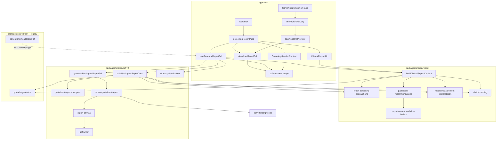

# MedScreen Festival — Architectural File Map

> **Generated:** STEP 0 discovery inventory  
> **Scope:** Current state documentation only — no code changes  
> **Purpose:** Complete architectural inventory before audit work (STEP 1+)

---

## Table of Contents

1. [Overall Project Structure](#1-overall-project-structure)
2. [Participant Report Flow — Download PDF](#2-participant-report-flow--download-pdf)
3. [PDF Architecture — Module Inventory](#3-pdf-architecture--module-inventory)
4. [Duplicate Implementations](#4-duplicate-implementations)
5. [Branding Assets](#5-branding-assets)
6. [Clinical Report Generation](#6-clinical-report-generation)
7. [Dependency Graph](#7-dependency-graph)
8. [Technical Debt](#8-technical-debt)

---

## 1. Overall Project Structure

### 1.1 Root layout

```
MedScreen Festival/
├── apps/
│   ├── api/          @medscreen/api   — Express REST API
│   └── web/          @medscreen/web   — React PWA (Vite)
├── packages/
│   ├── config/       @medscreen/config — env helpers
│   ├── shared/       @medscreen/shared — clinical engine, report content, PDF
│   ├── types/        @medscreen/types  — shared TypeScript domain types
│   └── ui/           @medscreen/ui     — shared UI (currently empty stub)
├── prisma/           PostgreSQL schema, migrations, seed
├── scripts/          Dev utility scripts
├── package.json      npm workspaces root (medscreen-festival)
└── FILE_MAP.md       ← this document
```

**Note:** There is no top-level `shared/` directory. Shared code lives in `packages/shared/`.  
**Git:** `.git/` not present in workspace; git CLI unavailable in environment — version control state could not be verified.

---

### 1.2 `apps/`

#### `apps/web/` — PWA client (`@medscreen/web`)

| Path | Purpose |
|------|---------|
| `src/app/router.tsx` | React Router — screening workflow routes |
| `src/app/providers.tsx` | App-level providers |
| `src/main.tsx` | Vite entry |
| `src/features/auth/` | Login, JWT auth context, protected routes |
| `src/features/campaign/` | Campaign selection |
| `src/features/dashboard/` | Dashboard home |
| `src/features/patients/` | Patient identification / form |
| `src/features/shell/` | Layout, sidebar, navigation, role routes |
| `src/features/screening/` | **Full screening workflow** (conversation → completion) |
| `src/shared/` | Web-only shared: API client, token storage, connection badge, touch input hook |

**Screening feature sub-modules (`apps/web/src/features/screening/`):**

| Subfolder | Files (approx.) | Role |
|-----------|-----------------|------|
| `conversation/` | hooks, components, lib, services, providers | AI conversation / anamnesis capture |
| `measurements/` | pages, components, hooks, lib | Vital signs input |
| `clinical/` | pages, components, hooks | Operator clinical results view |
| `report/` | **pages, hooks, components, lib, types** | **On-screen report + PDF generation** |
| `signature/` | pages, components, lib | Participant signature |
| `completion/` | pages | Final step + delivery options |
| `delivery/` | hooks, components, providers, types | Report delivery channels |
| `context/` | `ScreeningSessionContext.tsx` | Session state (patient, PDF, signature) |
| `lib/` | workflow, session storage | Step routing + persistence |
| `components/` | banners, action bar, guards | Shared screening UI |
| `hooks/` | `useStartNewScreening.ts` | Reset workflow |
| `pages/` | conversation entry page | |
| `test-*.ts` | integration test scripts | Dev-only |

#### `apps/api/` — REST API (`@medscreen/api`)

Clean Architecture layout:

| Layer | Path | Contents |
|-------|------|----------|
| Entry | `src/server.ts`, `src/app.ts` | HTTP server bootstrap |
| Presentation | `src/presentation/routes/`, `controllers/`, `middleware/` | auth, campaigns, patients, measurements, clinical, dashboard |
| Application | `src/application/` | use cases |
| Domain | `src/domain/repositories/`, `mappers/` | interfaces |
| Infrastructure | `src/infrastructure/database/`, `auth/`, `cors/`, `network/` | Prisma repos, JWT, CORS |

**PDF/report relevance:** **None.** No PDF or report endpoints exist in `apps/api/src/`. All PDF generation is client-side.

---

### 1.3 `packages/`

| Package | Export path | Role |
|---------|-------------|------|
| `@medscreen/types` | `.` | Domain types: auth, patient, campaign, measurements, clinical |
| `@medscreen/config` | `.` | Environment configuration |
| `@medscreen/shared` | `.` | Schemas, clinical engine, **report content**, re-exports report |
| `@medscreen/shared/pdf` | `./pdf` | **Legacy PDF renderer** (deprecated) |
| `@medscreen/shared/pdf-v2` | `./pdf-v2` | **Active PDF renderer** (participant report) |
| `@medscreen/ui` | `.` | Empty stub (`export {}`) |

#### `packages/shared/src/` — shared library internals

```
packages/shared/src/
├── index.ts                 Main export (schemas, clinical, report, utils)
├── clinical/                Clinical rules engine
│   ├── engine.ts
│   ├── demo-rule-set.ts
│   ├── rule-context.ts
│   └── rules/               cardiovascular, diabetes, sleep-apnea
├── report/                  Report content builders (UI + shared data)
├── pdf/                     Legacy PDF renderer (deprecated)
├── pdf-v2/                  Active PDF renderer
├── schemas/                 Zod validation schemas
├── constants/               roles
└── utils/                   phone helpers
```

#### `packages/types/src/`

- `auth.ts`, `patient.ts`, `campaign.ts`, `measurements.ts`, `clinical.ts`, `index.ts`

#### `packages/ui/src/`

- `index.ts` (empty), `styles/globals.css`

---

### 1.4 `prisma/`

| File | Purpose |
|------|---------|
| `schema.prisma` | PostgreSQL models: Role, User, Campaign, Patient, Screening, measurements |
| `seed.ts` | Database seed |
| `migrations/` | Auth, campaigns/dashboard, patients, screening/measurements |

**PDF/report relevance:** Screenings and measurements are persisted; **PDF bytes are not stored in DB** (sessionStorage only).

---

### 1.5 Shared libraries — cross-cutting

| Library | Location | Consumed by |
|---------|----------|-------------|
| Report content | `packages/shared/src/report/` | Web UI (`ClinicalReport`), PDF-v2 builder |
| Clinical engine | `packages/shared/src/clinical/` | API evaluate endpoint, web results, test scripts |
| PDF v2 | `packages/shared/src/pdf-v2/` | Web `useGenerateReportPdf` |
| PDF legacy | `packages/shared/src/pdf/` | Test/audit scripts only |
| Domain types | `packages/types/` | API, web, shared |

---

### 1.6 Directory checklist (requested paths)

| Requested path | Location in repo | Notes |
|----------------|------------------|-------|
| `apps/` | ✅ `apps/web`, `apps/api` | |
| `packages/` | ✅ 4 packages | config, shared, types, ui |
| `shared/` | ⚠️ No root `shared/` | → `packages/shared/` + `apps/web/src/shared/` |
| `report/` | ✅ `packages/shared/src/report/` + `apps/web/.../screening/report/` | Content vs UI |
| `pdf/` | ✅ `packages/shared/src/pdf/` | Legacy |
| `pdf-v2/` | ✅ `packages/shared/src/pdf-v2/` | Active |
| `hooks/` | ✅ Scattered by feature | No single `hooks/` root |
| `services/` | ✅ `apps/web/.../conversation/services/` | 1 file: orchestrator |
| `api/` | ✅ `apps/api/` | |
| `ui/` | ✅ `packages/ui/` | Empty stub |
| `components/` | ✅ Per-feature under `apps/web/src/features/*/components/` | |

---

## 2. Participant Report Flow — Download PDF

There are **two user-facing “Download PDF” entry points**. PDF **generation** happens earlier (on report page load). Download only retrieves already-generated bytes from session state.

### 2.1 Screening workflow order

```
/screening → /screening/measurements → /screening/results
  → /screening/report → /screening/signature → /screening/complete
```

Defined in: `apps/web/src/features/screening/lib/screening-workflow.ts`

---

### 2.2 Path A — Report page “Descarcă PDF” button

**Route:** `/screening/report` → `ScreeningReportPage.tsx`

#### Phase 1: PDF generation (automatic on page load)

| Step | File | Function / element |
|------|------|-------------------|
| 1 | `apps/web/src/app/router.tsx` | Route `screening/report` → `ScreeningReportPage` |
| 2 | `ScreeningReportPage.tsx` | Reads session via `useScreeningSession()` |
| 3 | `ScreeningReportPage.tsx` | Builds `reportProps` from patient, campaign, measurements, anamnesis, evaluation |
| 4 | `ScreeningReportPage.tsx` | `useEffect` → calls `generate(reportProps)` |
| 5 | `hooks/useGenerateReportPdf.ts` | `generate()` orchestrates PDF pipeline |
| 6 | `useGenerateReportPdf.ts` | `buildClinicalReportContent(input)` → filename metadata only |
| 7 | `packages/shared/src/report/clinical-report-content.ts` | `buildClinicalReportContent()` |
| 8 | `useGenerateReportPdf.ts` | `buildParticipantReportData(input)` |
| 9 | `packages/shared/src/pdf-v2/build-participant-report-data.ts` | `buildParticipantReportData()` |
| 10 | *(shared report modules)* | See [§6](#6-clinical-report-generation) |
| 11 | `pdf-v2/mappers/participant-report-mappers.ts` | `buildParticipantFindings()`, `buildParticipantRecommendationText()`, `formatMeasurementNote()`, `mapBadgeLevelToNoteLevel()` |
| 12 | `useGenerateReportPdf.ts` | `generateParticipantReportPdf(reportData)` |
| 13 | `pdf-v2/generate-participant-report-pdf.ts` | `generateParticipantReportPdf()` |
| 14 | `pdf-v2/fonts/font-loader.ts` | `loadSerifFontBytes()` |
| 15 | `pdf/fonts/liberation-serif-font-bytes.ts` | `decodeEmbeddedFont()` (shared font asset) |
| 16 | `pdf-v2/fonts/font-metrics.ts` | `parseSerifFontMetrics()` |
| 17 | `pdf-v2/assets/logo-loader.ts` | `loadClinicLogoBytes()` |
| 18 | `pdf-v2/assets/embedded-clinic-logo.ts` | `decodeEmbeddedClinicLogo()` |
| 19 | `pdf-v2/core/jpeg-image.ts` | `parseJpegImage()`, `embedJpegImage()` |
| 20 | `pdf-v2/fonts/font-embedder.ts` | `embedSerifFont()` |
| 21 | `pdf-v2/layout/render-participant-report.ts` | `renderParticipantReportContent()` |
| 22 | `pdf-v2/core/report-canvas.ts` | Drawing primitives (text, rules, table, QR, badges) |
| 23 | `pdf-v2/utils/qr-code.ts` | `generateQrMatrix()` (at render time) |
| 24 | `pdf-v2/core/pdf-writer.ts` | `PdfObjectCollector` — assembles PDF objects |
| 25 | `generate-participant-report-pdf.ts` | Returns `Uint8Array` PDF bytes |
| 26 | `useGenerateReportPdf.ts` | `pdfBytesToBase64(bytes)` |
| 27 | `pdf-v2/stored-pdf-validation.ts` | `pdfBytesToBase64()`, sets `PDF_V2_GENERATOR_VERSION` |
| 28 | `report/clinical-report-content.ts` | `buildClinicalReportFilename(content)` |
| 29 | `useGenerateReportPdf.ts` | Builds `StoredScreeningPdf` object |
| 30 | `report/lib/pdf-session-storage.ts` | `persistScreeningPdf(screeningId, stored)` |
| 31 | `context/ScreeningSessionContext.tsx` | `setGeneratedPdf(pdf)` — React state |
| 32 | `ScreeningReportPage.tsx` | Renders `ClinicalReport` (on-screen preview, separate pipeline) |

#### Phase 2: User clicks “Descarcă PDF”

| Step | File | Function |
|------|------|----------|
| 1 | `ScreeningReportPage.tsx` | `handleDownloadPdf()` — button `onClick` |
| 2 | `ScreeningReportPage.tsx` | Reads `generatedPdf` from session context |
| 3 | `report/lib/pdf-session-storage.ts` | `downloadStoredPdf(generatedPdf)` |
| 4 | `pdf-session-storage.ts` | `storedPdfToBlob(pdf)` — base64 → `Blob` |
| 5 | `pdf-session-storage.ts` | Creates `<a download>` + `URL.createObjectURL` + `click()` |
| 6 | Browser | File saved to device |

**Files involved (Path A — complete list):**

```
apps/web/src/app/router.tsx
apps/web/src/features/screening/report/pages/ScreeningReportPage.tsx
apps/web/src/features/screening/report/hooks/useGenerateReportPdf.ts
apps/web/src/features/screening/report/lib/pdf-session-storage.ts
apps/web/src/features/screening/report/components/ClinicalReport.tsx          (preview only)
apps/web/src/features/screening/report/components/ClinicalReportSections.tsx  (preview only)
apps/web/src/features/screening/report/types/clinical-report-props.ts
apps/web/src/features/screening/context/ScreeningSessionContext.tsx
apps/web/src/features/screening/components/StickyScreeningActionBar.tsx
apps/web/src/features/auth/context/AuthContext.tsx
apps/web/src/features/campaign/context/CampaignContext.tsx

packages/shared/src/report/clinical-report-content.ts
packages/shared/src/report/clinic-branding.ts
packages/shared/src/report/campaign-display.ts
packages/shared/src/report/report-datetime.ts
packages/shared/src/report/report-measurement-interpretation.ts
packages/shared/src/report/report-personalization.ts
packages/shared/src/report/report-number.ts
packages/shared/src/report/report-summary.ts
packages/shared/src/report/report-screening-observations.ts
packages/shared/src/pdf/qr-code-generator.ts                    (resolveClinicQrUrl only)

packages/shared/src/pdf-v2/index.ts
packages/shared/src/pdf-v2/build-participant-report-data.ts
packages/shared/src/pdf-v2/generate-participant-report-pdf.ts
packages/shared/src/pdf-v2/mappers/participant-report-mappers.ts
packages/shared/src/pdf-v2/types/participant-report.types.ts
packages/shared/src/pdf-v2/layout/render-participant-report.ts
packages/shared/src/pdf-v2/design/tokens.ts
packages/shared/src/pdf-v2/core/report-canvas.ts
packages/shared/src/pdf-v2/core/pdf-writer.ts
packages/shared/src/pdf-v2/core/jpeg-image.ts
packages/shared/src/pdf-v2/fonts/font-loader.ts
packages/shared/src/pdf-v2/fonts/font-metrics.ts
packages/shared/src/pdf-v2/fonts/font-embedder.ts
packages/shared/src/pdf-v2/assets/logo-loader.ts
packages/shared/src/pdf-v2/assets/embedded-clinic-logo.ts
packages/shared/src/pdf-v2/utils/qr-code.ts
packages/shared/src/pdf-v2/stored-pdf-validation.ts
packages/shared/src/pdf/fonts/liberation-serif-font-bytes.ts
```

---

### 2.3 Path B — Completion page delivery panel “Descarcă PDF”

**Route:** `/screening/complete` → `ScreeningCompletionPage.tsx`

| Step | File | Function |
|------|------|----------|
| 1 | `completion/pages/ScreeningCompletionPage.tsx` | Mounts with `generatedPdf` from session |
| 2 | `ScreeningCompletionPage.tsx` | `useReportDelivery({ pdf: generatedPdf, ... })` |
| 3 | `delivery/hooks/useReportDelivery.ts` | Exposes delivery `options` + `deliver(channel)` |
| 4 | `delivery/components/DeliveryOptionsPanel.tsx` | User clicks “Descarcă PDF” option |
| 5 | `DeliveryOptionsPanel.tsx` | `onDeliver('download')` |
| 6 | `useReportDelivery.ts` | `getDeliveryProvider('download')` |
| 7 | `delivery/providers/index.ts` | Returns `downloadPdfProvider` |
| 8 | `delivery/providers/download-pdf.provider.ts` | `deliver(context)` |
| 9 | `download-pdf.provider.ts` | `downloadStoredPdf(context.pdf)` |
| 10 | `report/lib/pdf-session-storage.ts` | Same blob/download logic as Path A |

**Additional files (Path B only):**

```
apps/web/src/features/screening/completion/pages/ScreeningCompletionPage.tsx
apps/web/src/features/screening/delivery/hooks/useReportDelivery.ts
apps/web/src/features/screening/delivery/components/DeliveryOptionsPanel.tsx
apps/web/src/features/screening/delivery/providers/index.ts
apps/web/src/features/screening/delivery/providers/download-pdf.provider.ts
apps/web/src/features/screening/delivery/types/delivery.types.ts
apps/web/src/features/screening/signature/lib/signature-session-storage.ts  (guard: signature required)
```

**Prerequisite:** PDF must already exist from Path A generation (`useGenerateReportPdf` on report page). Completion page redirects to `/screening/report` if `generatedPdf` is null.

---

### 2.4 Session persistence & hydration

| File | Role |
|------|------|
| `ScreeningSessionContext.tsx` | Holds `generatedPdf` in React state; hydrates from sessionStorage on load |
| `pdf-session-storage.ts` | `loadScreeningPdf()`, `persistScreeningPdf()`, `clearScreeningPdf()` |
| `pdf-v2/stored-pdf-validation.ts` | `isStoredParticipantReportPdfCompatible()` — rejects stale PDF cache (version 3) |
| `lib/screening-session-storage.ts` | Persists broader workflow session |
| `lib/screening-workflow-storage.ts` | Step persistence |

---

### 2.5 On-screen report preview (parallel, not download)

`ClinicalReport.tsx` calls `buildClinicalReportContent()` independently of PDF generation.  
**Important:** UI preview content **differs** from PDF output — see [§4](#4-duplicate-implementations) and [§8](#8-technical-debt).

---

## 3. PDF Architecture — Module Inventory

Legend:
- **Production** = used in live web app flow
- **Imported** = referenced by production code or active test scripts
- **Dead code** = no runtime path from app; orphaned or script-only with no CI wiring
- **Safe to remove** = assessment only; verify before deleting

### 3.1 Legacy renderer (`packages/shared/src/pdf/`)

| Module | Production | Imported | Dead code | Safe to remove |
|--------|:----------:|:--------:|:---------:|:--------------:|
| `index.ts` | NO | YES (test scripts) | NO | NO — export surface for tests |
| `pdf-document-builder.ts` | NO | YES (clinical-report-pdf) | NO | NO — legacy renderer core |
| `clinical-report-pdf.ts` | NO | YES (tests, legacy index) | NO | NO — reference + tests |
| `stored-pdf-validation.ts` | NO | YES (legacy index) | NO | NO — paired with legacy |
| `pdf-generator-version.ts` | NO | YES (legacy validation) | NO | NO |
| `pdf-unicode-text.ts` | NO | YES (pdf-document-builder) | NO | NO |
| `fonts/pdf-unicode-font-embedder.ts` | NO | YES (pdf-document-builder) | NO | NO |
| `fonts/ttf-metrics.ts` | NO | YES (legacy embedder) | NO | NO |
| `fonts/liberation-serif-font-bytes.ts` | **YES** | YES | NO | **NO — shared with PDF-v2** |
| `fonts/regenerate-liberation-serif-font-bytes.ts` | NO | NO | YES | YES — one-time dev tool |
| `fonts/validate-font-bytes.ts` | NO | YES (regenerate script) | YES | YES — dev tool |
| `qr-code-generator.ts` | **YES** | YES | NO | **NO — `resolveClinicQrUrl` used by PDF-v2 builder** |
| `test-pdf-generation.ts` | NO | NO | YES | YES — manual test |
| `test-pdf-text-integrity.ts` | NO | NO | YES | YES — manual test |
| `test-ui-pdf-package-path.ts` | NO | NO | YES | YES — manual test |
| `audit-pdf-unicode.ts` | NO | NO | YES | YES — manual audit |
| `investigate-pdf-encoding.ts` | NO | NO | YES | YES — manual debug |
| `check-ascii-gid-map.ts` | NO | NO | YES | YES — manual debug |

---

### 3.2 PDF-v2 — active renderer (`packages/shared/src/pdf-v2/`)

| Module | Production | Imported | Dead code | Safe to remove |
|--------|:----------:|:--------:|:---------:|:--------------:|
| `index.ts` | **YES** | YES | NO | NO |
| `generate-participant-report-pdf.ts` | **YES** | YES | NO | NO |
| `build-participant-report-data.ts` | **YES** | YES | NO | NO |
| `layout/render-participant-report.ts` | **YES** | YES | NO | NO |
| `types/participant-report.types.ts` | **YES** | YES | NO | NO |
| `mappers/participant-report-mappers.ts` | **YES** | YES | NO | NO |
| `design/tokens.ts` | **YES** | YES | NO | NO |
| `core/pdf-writer.ts` | **YES** | YES | NO | NO |
| `core/report-canvas.ts` | **YES** | YES | NO | NO |
| `core/jpeg-image.ts` | **YES** | YES | NO | NO |
| `core/png-image.ts` | NO | YES (mock/tests) | YES | YES — unused in prod path |
| `fonts/font-loader.ts` | **YES** | YES | NO | NO |
| `fonts/font-metrics.ts` | **YES** | YES | NO | NO |
| `fonts/font-embedder.ts` | **YES** | YES | NO | NO |
| `assets/logo-loader.ts` | **YES** | YES | NO | NO |
| `assets/embedded-clinic-logo.ts` | **YES** | YES | NO | NO |
| `assets/embed-clinic-logo.ts` | NO | YES (setup script) | YES | YES — one-time embed tool |
| `utils/qr-code.ts` | **YES** | YES | NO | NO |
| `stored-pdf-validation.ts` | **YES** | YES | NO | NO |
| `mock/dummy-participant-report.ts` | NO | YES (tests, index export) | YES | YES — dev/mock only |
| `mock/generate-mockup.ts` | NO | NO | YES | YES — manual |
| `mock/setup-font-asset.ts` | NO | NO | YES | YES — manual |
| `mock/participant-report-mockup.html` | NO | NO | YES | YES — design reference |
| `test-pdf-v2-mockup.ts` | NO | NO | YES | YES — manual test |
| `test-pdf-v2-integration.ts` | NO | NO | YES | YES — manual test |
| `README.md` | N/A | N/A | Stale | YES — outdated (see §8) |

---

### 3.3 Report content (`packages/shared/src/report/`)

| Module | Production | Imported | Dead code | Safe to remove |
|--------|:----------:|:--------:|:---------:|:--------------:|
| `clinical-report-content.ts` | **YES** | YES | NO | NO |
| `clinic-branding.ts` | **YES** | YES | NO | NO |
| `campaign-display.ts` | **YES** | YES | NO | NO |
| `report-datetime.ts` | **YES** | YES | NO | NO |
| `report-measurement-interpretation.ts` | **YES** | YES | NO | NO |
| `report-personalization.ts` | **YES** | YES | NO | NO |
| `report-number.ts` | **YES** | YES | NO | NO |
| `report-summary.ts` | **YES** | YES | NO | NO |
| `report-screening-observations.ts` | **YES** | YES | NO | NO |
| `participant-recommendations.ts` | **YES** (UI only) | YES | NO | NO — used by UI, not PDF |
| `report-recommendation-bullets.ts` | **YES** (UI only) | YES | NO | NO — used by UI, not PDF |
| `report-formatters.ts` | NO | YES (indirect) | MAYBE | Review before remove |
| `test-participant-recommendations.ts` | NO | NO | YES | YES — manual test |
| `index.ts` | **YES** | YES | NO | NO |

---

### 3.4 Web report layer (`apps/web/src/features/screening/report/`)

| Module | Production | Imported | Dead code | Safe to remove |
|--------|:----------:|:--------:|:---------:|:--------------:|
| `pages/ScreeningReportPage.tsx` | **YES** | YES | NO | NO |
| `hooks/useGenerateReportPdf.ts` | **YES** | YES | NO | NO |
| `lib/pdf-session-storage.ts` | **YES** | YES | NO | NO |
| `components/ClinicalReport.tsx` | **YES** | YES | NO | NO |
| `components/ClinicalReportSections.tsx` | **YES** | YES | NO | NO |
| `types/clinical-report-props.ts` | **YES** | YES | NO | NO |
| `test-report-ui-flow.ts` | NO | NO | YES | YES — manual test |

---

### 3.5 Delivery layer

| Module | Production | Imported | Dead code | Safe to remove |
|--------|:----------:|:--------:|:---------:|:--------------:|
| `download-pdf.provider.ts` | **YES** | YES | NO | NO |
| `print-delivery.provider.ts` | YES (shown) | YES | **Stub** | NO — UI placeholder |
| `email-delivery.provider.ts` | YES (shown) | YES | **Stub** | NO — UI placeholder |
| `whatsapp-delivery.provider.ts` | YES (shown) | YES | **Stub** | NO — UI placeholder |
| `useReportDelivery.ts` | **YES** | YES | NO | NO |
| `DeliveryOptionsPanel.tsx` | **YES** | YES | NO | NO |

---

## 4. Duplicate Implementations

### 4.1 PDF renderers (two complete stacks)

| Aspect | Legacy (`pdf/`) | Active (`pdf-v2/`) |
|--------|-----------------|---------------------|
| Entry | `generateClinicalReportPdf()` | `generateParticipantReportPdf()` |
| Builder | `PdfDocumentBuilder` class | `PdfObjectCollector` + `ReportCanvas` |
| Data model | `ClinicalReportContent` | `ParticipantReportData` |
| Used in app | **NO** | **YES** |
| Font embed | `pdf-unicode-font-embedder.ts` | `font-embedder.ts` |
| Font metrics | `ttf-metrics.ts` | `font-metrics.ts` |
| QR draw | Via `ClinicalReportContent.qrMatrix` precomputed | `generateQrMatrix()` at render time |

---

### 4.2 QR code generators (near-identical)

| File | Used by |
|------|---------|
| `pdf/qr-code-generator.ts` | `clinical-report-content.ts` (`generateQrMatrix`, `resolveClinicQrUrl`); `build-participant-report-data.ts` (`resolveClinicQrUrl` only) |
| `pdf-v2/utils/qr-code.ts` | `render-participant-report.ts` (`generateQrMatrix` only) |

**Duplication:** Two self-contained QR Model 2 implementations (~270+ lines each). Same algorithm, separate files.

---

### 4.3 Base64 PDF utilities

| File | Functions |
|------|-----------|
| `pdf-v2/stored-pdf-validation.ts` | `pdfBytesToBase64`, `base64ToPdfBytes` — **used in production** |
| `pdf/clinical-report-pdf.ts` | `pdfBytesToBase64`, `base64ToPdfBytes` — legacy/tests only |

---

### 4.4 Stored PDF validation (two version systems)

| File | Version constant | Used by |
|------|------------------|---------|
| `pdf-v2/stored-pdf-validation.ts` | `PDF_V2_GENERATOR_VERSION = 3` | Web session storage |
| `pdf/stored-pdf-validation.ts` | `PDF_GENERATOR_VERSION = 2` | Legacy only |

---

### 4.5 Recommendation generators (three paths)

| Generator | File | Output | Used by |
|-----------|------|--------|---------|
| Personalized engine | `participant-recommendations.ts` | `ClinicalRecommendation[]` | **UI only** via `clinical-report-content.ts` |
| Bullet mapper | `report-recommendation-bullets.ts` | `string[]` bullets | **UI only** |
| PDF simplified text | `participant-report-mappers.ts` → `buildParticipantRecommendationText()` | Single paragraph | **PDF only** |

**Result:** On-screen report shows detailed specialist bullets; PDF shows one generic paragraph.

---

### 4.6 Findings / observations (two presentations)

| Path | Source | Display |
|------|--------|---------|
| UI | `report-screening-observations.ts` → raw keys e.g. `"tensiune arterială crescută"` | Shown verbatim in `ClinicalReportScreeningObservations` |
| PDF | Same observations → `buildParticipantFindings()` in mappers | Patient-friendly labels e.g. `"Tensiune arterială peste valorile recomandate"` |

**Duplication:** Threshold logic duplicated between `report-screening-observations.ts` and `participant-recommendations.ts` (similar BP/glucose/BMI constants).

---

### 4.7 Report data models (two types)

| Model | File | Consumer |
|-------|------|----------|
| `ClinicalReportContent` | `clinical-report-content.ts` | Web UI, legacy PDF |
| `ParticipantReportData` | `participant-report.types.ts` | PDF-v2 |

Both built from same `ClinicalReportInput` but through different builders.

---

### 4.8 Measurement row mapping

| Step | Shared | PDF-specific |
|------|--------|--------------|
| Build rows | `buildPremiumMeasurementRows()` | — |
| Map to PDF | — | `formatMeasurementNote()`, `mapBadgeLevelToNoteLevel()` in mappers |

UI uses `PremiumMeasurementRow` directly; PDF remaps interpretation strings.

---

### 4.9 Header / branding rendering

| Surface | Implementation |
|---------|----------------|
| UI header | `ClinicalReportSections.tsx` → `ClinicalReportClinicHeader` (React + Tailwind + SVG QR) |
| PDF header | `render-participant-report.ts` (canvas drawing + embedded JPEG logo + PDF QR) |

No shared layout component between UI and PDF.

---

## 5. Branding Assets

### 5.1 Clinic identity (text)

**File:** `packages/shared/src/report/clinic-branding.ts`

| Constant | Value |
|----------|-------|
| `CLINIC_BRANDING.name` | Dr. Lungu Family |
| `CLINIC_BRANDING.slogan` | Grijă pentru sănătate |
| `CLINIC_BRANDING.phone` | 0755 75 45 45 |
| `CLINIC_BRANDING.address` | Aleea Spitalului nr. 16, etaj 1, Pitești... |
| `CLINIC_BRANDING.website` | www.drlungufamily.ro |
| `CLINIC_BRANDING.contactPageUrl` | www.drlungufamily.ro/contact |
| `BLOOD_PRESSURE_EDUCATION` | UI-only educational block |
| `CLINICAL_REPORT_DISCLAIMER` | UI disclaimer paragraphs |

---

### 5.2 Clinic logo (image)

| Asset | Location | Format | Used by |
|-------|----------|--------|---------|
| Embedded JPEG (base64) | `pdf-v2/assets/embedded-clinic-logo.ts` | JPEG bytes via `EMBEDDED_CLINIC_LOGO_JPEG_BASE64` | PDF-v2 only |
| Loader | `pdf-v2/assets/logo-loader.ts` | — | `generate-participant-report-pdf.ts` |
| Embed tool | `pdf-v2/assets/embed-clinic-logo.ts` | One-time script | Dev only |
| README reference | `pdf-v2/assets/clinic-logo.jpg` | **Not present as standalone file** — only embedded TS |

**UI:** No clinic logo image in web report header — text-only header in `ClinicalReportClinicHeader`.

---

### 5.3 Colors

| Source | Colors | Used by |
|--------|--------|---------|
| `pdf-v2/design/tokens.ts` | Navy `#003D5B`, Green `#38A649`, table/badge palette | PDF-v2 renderer |
| Tailwind / CSS (`apps/web`) | `brand-primary`, `brand-accent`, etc. | Web UI |
| `ClinicalReportSections.tsx` | Tailwind emerald/amber badge classes | UI measurement badges |

**No shared color token file** between PDF and web.

---

### 5.4 Typography

| Surface | Font | Source |
|---------|------|--------|
| PDF-v2 | Liberation Serif (Regular) | `pdf/fonts/liberation-serif-font-bytes.ts` → `pdf-v2/fonts/font-loader.ts` |
| PDF-v2 embed | Identity-H + CIDToGIDMap | `pdf-v2/fonts/font-embedder.ts` |
| Web report | `font-serif` (Tailwind) | Browser/system serif stack |
| PDF legacy | Liberation Serif Regular + Bold | `pdf-document-builder.ts` |

---

### 5.5 QR generation

| Function | File | Used when |
|----------|------|-----------|
| `resolveClinicQrUrl(clinic)` | `pdf/qr-code-generator.ts` | Building report data (UI + PDF) |
| `generateQrMatrix(text)` | `pdf/qr-code-generator.ts` | UI preview (`ClinicalReportContent.qrMatrix`) |
| `generateQrMatrix(text)` | `pdf-v2/utils/qr-code.ts` | PDF render (duplicate implementation) |

QR encodes clinic contact URL derived from `CLINIC_BRANDING`.

---

### 5.6 Header rendering

| Surface | File | Method |
|---------|------|--------|
| Web | `ClinicalReportSections.tsx` → `ClinicalReportClinicHeader` | React components, SVG QR, campaign lines |
| PDF-v2 | `render-participant-report.ts` § Header | `ReportCanvas.drawImage('Logo')`, text fields, `drawQr()` |
| PDF legacy | `pdf-document-builder.ts` → `drawProfessionalHeader()` | PDF operators |

---

## 6. Clinical Report Generation

### 6.1 Input type

**`ClinicalReportInput`** — `packages/shared/src/report/clinical-report-content.ts`

Fields: participant, campaign, screeningDate, operatorName, measurements, anamnesis, evaluation.

---

### 6.2 Findings generation

```
measurements + anamnesis + gender
        │
        ▼
buildScreeningObservations()          ← report-screening-observations.ts
        │
        ├──► UI: raw observation strings
        │
        └──► PDF: buildParticipantFindings()     ← pdf-v2/mappers/participant-report-mappers.ts
                    maps to patient-friendly labels
```

**Threshold constants** also exist independently in:
- `participant-recommendations.ts` (for recommendation codes)
- `report-measurement-interpretation.ts` (for badge levels)

---

### 6.3 Recommendations generation

#### UI path (detailed bullets)

```
measurements + anamnesis + gender
        │
        ▼
buildPersonalizedParticipantRecommendations()   ← participant-recommendations.ts
        │ produces ClinicalRecommendation[]
        ▼
buildParticipantRecommendationBullets()       ← report-recommendation-bullets.ts
        │ maps codes → Romanian bullet strings
        ▼
ClinicalReport → ClinicalReportRecommendations section
```

#### PDF path (single paragraph)

```
findings.length
        │
        ▼
buildParticipantRecommendationText()            ← pdf-v2/mappers/participant-report-mappers.ts
        │
        ▼
ParticipantReportData.recommendations.recommendationText
        │
        ▼
render-participant-report.ts → recommendation card
```

**Note:** `participant-recommendations.ts` and `report-recommendation-bullets.ts` are **not used** by PDF-v2.

---

### 6.4 Measurements mapping

```
MedicalMeasurements + gender
        │
        ▼
buildPremiumMeasurementRows()                   ← report-measurement-interpretation.ts
        │ PremiumMeasurementRow[]
        │
        ├──► UI: ClinicalReportMeasurements (badges via Tailwind)
        │
        └──► PDF: buildParticipantReportData() remaps each row:
                 formatMeasurementNote()
                 mapBadgeLevelToNoteLevel()
                 → ParticipantReportMeasurement[]
```

---

### 6.5 Summary generation

```
hasFindings (boolean)
        │
        ▼
buildReportSummaryLines()                       ← report-summary.ts
        │
        ├──► UI: ClinicalReportSummary
        └──► PDF: data.summaryLines (max 4 lines in renderer)
```

Both paths use the same function. `hasFindings` derived from `screeningObservations.length > 0` in both builders.

---

### 6.6 Full builder comparison

| Concern | UI builder | PDF builder |
|---------|------------|-------------|
| Entry | `buildClinicalReportContent()` | `buildParticipantReportData()` |
| File | `clinical-report-content.ts` | `pdf-v2/build-participant-report-data.ts` |
| Findings | Raw observations | Mapped findings |
| Recommendations | Bullet list | Single paragraph |
| BP education | Included conditionally | **Not rendered in PDF-v2** |
| Disclaimer | UI component | Hardcoded in PDF footer |
| QR | Precomputed matrix in content | URL in data; matrix at render |

---

## 7. Dependency Graph

### 7.1 High-level application flow



---

### 7.2 PDF generation call tree

```
useGenerateReportPdf.generate(props)
├── buildClinicalReportContent(input)          [filename + screeningId only in practice]
│   ├── getParticipantDisplayName()
│   ├── formatScreeningDateTime()
│   ├── buildScreeningObservations()
│   ├── buildPersonalizedParticipantRecommendations()  ← UI path data (unused by PDF)
│   ├── buildReportSummaryLines()
│   ├── buildPremiumMeasurementRows()
│   ├── buildCampaignEventDisplay()
│   ├── buildStableReportNumber()
│   ├── resolveOperatorDisplayName()
│   ├── resolveClinicQrUrl()
│   └── generateQrMatrix()                     ← computed but unused by PDF-v2
│
├── buildParticipantReportData(input)
│   ├── (same shared report helpers as above, minus recommendations bullets)
│   ├── buildParticipantFindings()
│   └── buildParticipantRecommendationText()
│
├── generateParticipantReportPdf(reportData)
│   ├── loadSerifFontBytes() → liberation-serif-font-bytes.ts
│   ├── parseSerifFontMetrics()
│   ├── loadClinicLogoBytes() → embedded-clinic-logo.ts
│   ├── parseJpegImage() / embedJpegImage()
│   ├── embedSerifFont()
│   ├── renderParticipantReportContent()
│   │   ├── generateQrMatrix()               ← pdf-v2/utils/qr-code.ts
│   │   └── ReportCanvas drawing methods
│   └── PdfObjectCollector.finalize() → Uint8Array
│
├── pdfBytesToBase64()
├── buildClinicalReportFilename()
└── persistScreeningPdf() → sessionStorage
```

---

### 7.3 Package import edges (production)

```
@medscreen/web
  → @medscreen/shared          (report content, clinical)
  → @medscreen/shared/pdf-v2   (PDF generation, validation)
  → @medscreen/types
  → @medscreen/config
  → @medscreen/ui              (empty)

@medscreen/shared/pdf-v2
  → ../report/*                (content builders)
  → ../pdf/qr-code-generator   (resolveClinicQrUrl only)
  → ../pdf/fonts/liberation-serif-font-bytes.ts

@medscreen/api
  → @medscreen/shared          (clinical engine)
  → @medscreen/types
  (no PDF imports)
```

---

## 8. Technical Debt

### 8.1 Critical — UI/PDF content divergence

| Issue | Impact |
|-------|--------|
| UI shows raw `screeningObservations`; PDF shows mapped `findings` | Participant sees different finding text on screen vs downloaded PDF |
| UI shows detailed recommendation **bullets**; PDF shows **one generic paragraph** | PDF omits specialist-specific guidance shown on screen |
| UI includes **blood pressure education** block; PDF-v2 **does not render it** | Information loss in downloaded report |
| `buildClinicalReportContent()` called during PDF gen but most output unused | Wasted computation; misleading comment "same pipeline as PDF" in `ClinicalReport.tsx` |

---

### 8.2 Architecture — dual PDF stacks

| Issue | Impact |
|-------|--------|
| Legacy `pdf/` coexists with `pdf-v2/` | Maintenance burden, confusion about source of truth |
| `pdf-v2/README.md` states "not wired to app" | **Incorrect** — contradicts actual integration |
| Two QR implementations | Bug fixes must be applied twice |
| Two base64 utility pairs | Minor duplication |

---

### 8.3 Architecture — no server-side PDF

| Issue | Impact |
|-------|--------|
| PDF generated entirely client-side | No audit trail, no server archive, device-dependent |
| PDF stored in `sessionStorage` only | Lost on tab close; not synced to backend |
| No API report endpoints | Cannot regenerate from server; no email/WhatsApp backend |

---

### 8.4 Architecture — shared logic duplication

| Issue | Impact |
|-------|--------|
| Clinical thresholds duplicated across `report-screening-observations.ts`, `participant-recommendations.ts`, `report-measurement-interpretation.ts` | Risk of inconsistent clinical cutoffs |
| Separate UI/PDF data models (`ClinicalReportContent` vs `ParticipantReportData`) | Requires dual maintenance for layout changes |

---

### 8.5 Branding inconsistency

| Issue | Impact |
|-------|--------|
| Logo embedded in PDF only | Web report header has no clinic logo image |
| Colors defined separately (PDF tokens vs Tailwind) | Visual drift between screen and print |
| Web uses system serif; PDF uses Liberation Serif | Typography mismatch |

---

### 8.6 Delivery stubs

| Issue | Impact |
|-------|--------|
| WhatsApp, email, print providers are placeholders | Shown in UI but non-functional (`isImplemented: false` except download) |
| Print provider calls `storedPdfToBlob` then returns failure | Dead code path |

---

### 8.7 Package / project hygiene

| Issue | Impact |
|-------|--------|
| `@medscreen/ui` is empty stub | Dependency without value |
| No git repository detected in workspace | No change tracking visible |
| Manual test scripts not wired to `npm test` | Regression risk for PDF/report |
| `useGenerateReportPdf.ts` has excessive blank lines | Formatting noise (cosmetic) |
| `capture-report-previews.ts` referenced in dist but absent from src | Possible stale build artifact |

---

### 8.8 Documentation drift

| Document | Stated | Actual |
|----------|--------|--------|
| `pdf-v2/README.md` | "Public exports (not wired to app)" | Wired via `useGenerateReportPdf` |
| `pdf-v2/README.md` | "Currently only DUMMY_PARTICIPANT_REPORT is used" | Real data via `buildParticipantReportData` |
| `pdf-v2/README.md` | "Replace legacy renderer — after approval" | Legacy unused; v2 already active |
| `ClinicalReport.tsx` comment | "same pipeline as PDF generation" | Different builders; different output |

---

## Appendix A — All report/PDF-related source files

### Web (`apps/web/src/`)

```
features/screening/report/pages/ScreeningReportPage.tsx
features/screening/report/hooks/useGenerateReportPdf.ts
features/screening/report/lib/pdf-session-storage.ts
features/screening/report/components/ClinicalReport.tsx
features/screening/report/components/ClinicalReportSections.tsx
features/screening/report/types/clinical-report-props.ts
features/screening/report/test-report-ui-flow.ts
features/screening/completion/pages/ScreeningCompletionPage.tsx
features/screening/delivery/hooks/useReportDelivery.ts
features/screening/delivery/components/DeliveryOptionsPanel.tsx
features/screening/delivery/providers/index.ts
features/screening/delivery/providers/download-pdf.provider.ts
features/screening/delivery/providers/print-delivery.provider.ts
features/screening/delivery/providers/email-delivery.provider.ts
features/screening/delivery/providers/whatsapp-delivery.provider.ts
features/screening/delivery/types/delivery.types.ts
features/screening/context/ScreeningSessionContext.tsx
features/screening/lib/screening-workflow.ts
features/screening/lib/screening-session-storage.ts
features/screening/lib/screening-workflow-storage.ts
app/router.tsx
```

### Shared report (`packages/shared/src/report/`)

```
clinical-report-content.ts
clinic-branding.ts
campaign-display.ts
report-datetime.ts
report-measurement-interpretation.ts
report-personalization.ts
report-number.ts
report-summary.ts
report-screening-observations.ts
participant-recommendations.ts
report-recommendation-bullets.ts
report-formatters.ts
test-participant-recommendations.ts
index.ts
```

### PDF v2 (`packages/shared/src/pdf-v2/`)

```
index.ts
generate-participant-report-pdf.ts
build-participant-report-data.ts
stored-pdf-validation.ts
types/participant-report.types.ts
mappers/participant-report-mappers.ts
layout/render-participant-report.ts
design/tokens.ts
core/pdf-writer.ts
core/report-canvas.ts
core/jpeg-image.ts
core/png-image.ts
fonts/font-loader.ts
fonts/font-metrics.ts
fonts/font-embedder.ts
assets/logo-loader.ts
assets/embedded-clinic-logo.ts
assets/embed-clinic-logo.ts
utils/qr-code.ts
mock/dummy-participant-report.ts
mock/generate-mockup.ts
mock/setup-font-asset.ts
mock/participant-report-mockup.html
test-pdf-v2-mockup.ts
test-pdf-v2-integration.ts
README.md
```

### PDF legacy (`packages/shared/src/pdf/`)

```
index.ts
clinical-report-pdf.ts
pdf-document-builder.ts
pdf-unicode-text.ts
stored-pdf-validation.ts
pdf-generator-version.ts
qr-code-generator.ts
fonts/liberation-serif-font-bytes.ts
fonts/pdf-unicode-font-embedder.ts
fonts/ttf-metrics.ts
fonts/regenerate-liberation-serif-font-bytes.ts
fonts/validate-font-bytes.ts
test-pdf-generation.ts
test-pdf-text-integrity.ts
test-ui-pdf-package-path.ts
audit-pdf-unicode.ts
investigate-pdf-encoding.ts
check-ascii-gid-map.ts
```

---

## Appendix B — STEP 0 completion status

| Task | Status |
|------|--------|
| Workspace inventory | ✅ Complete |
| Directory mapping | ✅ Complete |
| Download PDF execution trace | ✅ Complete |
| PDF architecture module audit | ✅ Complete |
| Duplicate detection | ✅ Complete |
| Branding asset location | ✅ Complete |
| Clinical generation map | ✅ Complete |
| Dependency graph | ✅ Complete |
| Technical debt list | ✅ Complete |
| Saved as `FILE_MAP.md` | ✅ This file |

**Next step:** STEP 1 — await user approval before any code changes or audit fixes.

---

*End of FILE_MAP.md*
