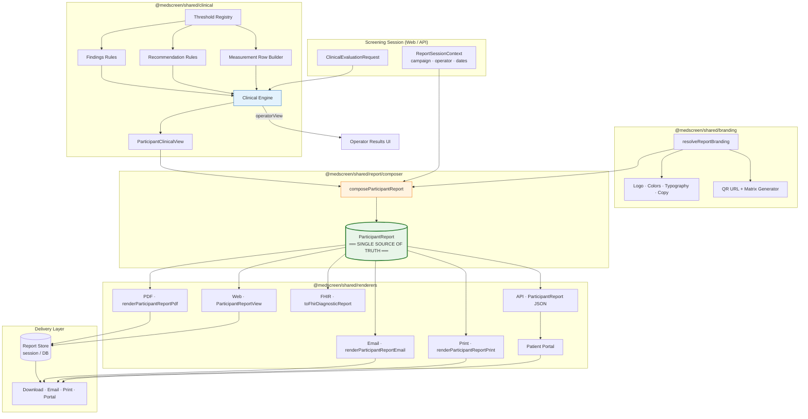

# MedScreen Festival — Target Architecture (STEP 2)

> **Status:** Design only — no code changes, no implementation  
> **Approved input:** [`ARCHITECTURE_AUDIT.md`](./ARCHITECTURE_AUDIT.md), [`FILE_MAP.md`](./FILE_MAP.md)  
> **Horizon:** 10-year maintainability for a premium medical screening platform

---

## Design principles

1. **One model, many renderers** — clinical meaning is resolved once; every channel reads the same `ParticipantReport`.
2. **Engine owns clinical truth** — thresholds, findings, recommendations, and measurement interpretation live in the clinical layer, not in PDF or React.
3. **Renderers draw; they never decide** — PDF, UI, email, and print are presentation adapters with zero business logic.
4. **Branding is data, not layout** — clinic identity is a versioned asset bundle referenced by the report model; each renderer applies its own layout rules against the same bundle.
5. **Operator view ≠ participant report** — the operator dashboard may show richer clinical detail, but participant-facing text is produced in one pipeline and copied verbatim into the report.
6. **YAGNI on abstractions** — no generic “report plugin framework” until a third renderer justifies it. One builder + typed renderers is enough for release.

---

## 1. Ideal data flow

### 1.1 End-to-end execution (target state)

```
┌─────────────────────────────────────────────────────────────────────────┐
│  SCREENING SESSION (web)                                                │
│  Patient · Anamnesis · Measurements · Campaign · Operator               │
└───────────────────────────────────┬─────────────────────────────────────┘
                                    │
                                    ▼
┌─────────────────────────────────────────────────────────────────────────┐
│  CLINICAL ENGINE  (@medscreen/shared/clinical)                          │
│  Input:  ClinicalEvaluationRequest                                      │
│  Output: ClinicalEvaluationResult                                       │
│          ├── operatorView    (risks, warnings, interpretation)          │
│          └── participantView (findings, recommendations, measurements,  │
│                               summary, optional education blocks)       │
│                                                                         │
│  • Thresholds evaluated HERE ONLY                                       │
│  • Findings labels finalized HERE ONLY                                  │
│  • Recommendations text finalized HERE ONLY                             │
│  • Measurement rows finalized HERE ONLY                                 │
└───────────────────────────────────┬─────────────────────────────────────┘
                                    │
                                    ▼
┌─────────────────────────────────────────────────────────────────────────┐
│  REPORT COMPOSER  (@medscreen/shared/report/composer)                   │
│  Input:  ClinicalEvaluationResult.participantView                       │
│          + ReportSessionContext (campaign, operator, screening date)    │
│          + ResolvedReportBranding (from branding module)                │
│  Output: ParticipantReport  ← THE SINGLE SOURCE OF TRUTH                │
│                                                                         │
│  • NO clinical interpretation                                           │
│  • NO duplicate mapping                                                 │
│  • Assembly only: IDs, filenames, QR URL, report number, metadata       │
└───────────────────────────────────┬─────────────────────────────────────┘
                                    │
          ┌─────────────────────────┼─────────────────────────┐
          │                         │                         │
          ▼                         ▼                         ▼
┌──────────────────┐   ┌──────────────────┐   ┌──────────────────────────┐
│  UI RENDERER     │   │  PDF RENDERER    │   │  FUTURE RENDERERS         │
│  React adapter   │   │  pdf-v2 draw-only│   │  Email · Print · Portal   │
│                  │   │                  │   │  FHIR · JSON API          │
└────────┬─────────┘   └────────┬─────────┘   └────────────┬─────────────┘
         │                      │                          │
         └──────────────────────┴──────────────────────────┘
                                    │
                                    ▼
                         Delivery / storage / download
                         (sessionStorage today; server archive later)
```

### 1.2 Step-by-step flow (numbered)

| Step | Layer | Action |
|------|-------|--------|
| 1 | Web session | Collect `ClinicalEvaluationRequest` (measurements, anamnesis, patient, screening IDs) |
| 2 | API / shared | `evaluateClinicalEngine(request)` → `ClinicalEvaluationResult` |
| 3 | Clinical engine | Produce `participantView` with display-ready findings, recommendations, measurements, summary lines |
| 4 | Branding module | `resolveReportBranding(clinicId, channel?)` → `ResolvedReportBranding` (logo ref, colors, typography tokens, footer text) |
| 5 | Report composer | `composeParticipantReport({ evaluation, session, branding })` → `ParticipantReport` |
| 6a | UI renderer | `ParticipantReportView({ report })` — maps model fields to React components |
| 6b | PDF renderer | `renderParticipantReportPdf(report)` → `Uint8Array` — draws only |
| 6c | Future | `renderParticipantReportEmail(report)`, `toFhirDiagnosticReport(report)`, etc. |
| 7 | Delivery | Store/transmit serialized `ParticipantReport` or rendered artifact + metadata |

### 1.3 What changes vs today

| Today | Target |
|-------|--------|
| `buildClinicalReportContent()` + `buildParticipantReportData()` in parallel | **One** `composeParticipantReport()` |
| UI reads `ClinicalReportContent`; PDF reads `ParticipantReportData` | Both read `ParticipantReport` |
| `buildPersonalizedParticipantRecommendations()` separate from engine | Recommendations inside engine `participantView` |
| `buildParticipantFindings()` in PDF mappers | Findings inside engine `participantView` |
| `formatMeasurementNote()` in PDF mappers | Final measurement display fields in engine output |
| PDF generates QR matrix at draw time | QR **payload** (URL + precomputed matrix optional) attached in composer |

---

## 2. Report model

### 2.1 Canonical type: `ParticipantReport`

One immutable document snapshot. Versioned schema (`report_schema_version: 1`).

```typescript
/** Single source of truth for all participant-facing report outputs. */
interface ParticipantReport {
  schema_version: 1;

  metadata: ReportMetadata;
  clinic: ReportClinicBlock;
  event: ReportEventBlock;
  participant: ReportParticipantBlock;
  summary: ReportSummaryBlock;
  measurements: ReportMeasurementsBlock;
  findings: ReportFindingsBlock;
  recommendations: ReportRecommendationsBlock;
  education: ReportEducationBlock[];      // 0..n optional blocks (e.g. BP tips)
  footer: ReportFooterBlock;
  branding: ReportBrandingSnapshot;       // resolved at compose time
  qr: ReportQrBlock;
}
```

### 2.2 Block definitions

#### `ReportMetadata`
| Field | Purpose |
|-------|---------|
| `report_id` | Stable ID (= screening_id) |
| `report_number` | Display number `SM-YYYY-XXXXXX` |
| `report_title` | e.g. `RAPORT DE SCREENING MEDICAL` |
| `screening_date` | ISO + display date/time lines |
| `generated_at` | ISO timestamp |
| `engine_version` | Clinical engine version |
| `rule_set_id` | Rule set used |
| `report_composer_version` | For cache invalidation |
| `filename` | Precomputed download filename |

#### `ReportClinicBlock`
| Field | Source |
|-------|--------|
| `name`, `slogan`, `phone`, `address`, `website`, `email` | Branding module |

#### `ReportEventBlock`
| Field | Source |
|-------|--------|
| `festival_name`, `edition`, `sponsor_name`, `work_point` | Campaign composer (non-clinical) |

#### `ReportParticipantBlock`
| Field | Source |
|-------|--------|
| `display_name`, `age`, `gender` (optional in PDF) | Personalization helper — called once in composer |

#### `ReportSummaryBlock`
| Field | Source |
|-------|--------|
| `lines: string[]` | Engine `participantView.summaryLines` |

#### `ReportMeasurementsBlock`
| Field | Source |
|-------|--------|
| `rows: ReportMeasurementRow[]` | Engine `participantView.measurements` |
| `column_labels` | Fixed in schema (same labels UI + PDF) |

Each `ReportMeasurementRow`:
```typescript
interface ReportMeasurementRow {
  parameter: string;           // "Tensiune arterială"
  result: string;              // "142 / 88"
  reference_range: string;     // "sub 140/90"
  status_label: string;        // "Peste interval" — FINAL display text
  status_level: 'normal' | 'attention' | 'critical' | 'neutral';
}
```

#### `ReportFindingsBlock`
| Field | Source |
|-------|--------|
| `section_title` | Constant in schema: `"Ce a identificat screeningul"` (one title everywhere) |
| `items: ReportFinding[]` | Engine — final patient-facing strings |

```typescript
interface ReportFinding {
  code: string;                // stable internal code, e.g. "bp_elevated"
  label: string;               // FINAL Romanian text shown to participant
}
```

#### `ReportRecommendationsBlock`
| Field | Source |
|-------|--------|
| `intro: string` | Engine — single intro line |
| `items: ReportRecommendation[]` | Engine — FINAL display items |

```typescript
interface ReportRecommendation {
  code: string;
  text: string;                // FULL participant-facing sentence or bullet — no remapping
  priority: 'routine' | 'soon' | 'urgent';
}
```

**Design choice:** UI renders `items` as bullets; PDF may render as card or list — but **text is identical**. PDF must not collapse to a generic paragraph.

#### `ReportEducationBlock` (optional)
```typescript
interface ReportEducationBlock {
  code: string;                // e.g. "bp_measurement_tips"
  title: string;
  items: string[];
}
```
Engine or composer adds when clinically indicated (e.g. abnormal BP). Same block appears in UI and PDF.

#### `ReportFooterBlock`
| Field | Source |
|-------|--------|
| `disclaimer_paragraphs: string[]` | Branding module |
| `operator_name` | Session |
| `clinic_name` | Branding |

#### `ReportBrandingSnapshot`
Frozen at compose time so re-rendering old reports is deterministic:
```typescript
interface ReportBrandingSnapshot {
  branding_version: string;
  logo: { asset_id: string; mime: 'image/jpeg' | 'image/svg+xml' };
  colors: ReportColorTokens;
  typography: ReportTypographyTokens;
}
```

#### `ReportQrBlock`
```typescript
interface ReportQrBlock {
  url: string;
  matrix?: boolean[][];        // optional precompute in composer for parity; renderers may regenerate from url ONLY if algorithm version pinned
  algorithm_version: string;
}
```

### 2.3 Models that must disappear

| Current model / file | Disposition | Reason |
|---------------------|-------------|--------|
| `ClinicalReportContent` | **Remove** | Replaced by `ParticipantReport` |
| `ParticipantReportData` | **Remove** | Replaced by `ParticipantReport` |
| `buildClinicalReportContent()` | **Remove** | Replaced by `composeParticipantReport()` |
| `buildParticipantReportData()` | **Remove** | Replaced by `composeParticipantReport()` |
| `PremiumMeasurementRow` (as public report type) | **Internalize** | Becomes engine-internal; report uses `ReportMeasurementRow` |
| `ParticipantReportRecommendations.recommendationText` (single string) | **Remove** | Replaced by structured `ReportRecommendationsBlock` |
| PDF `participant-report-mappers.ts` | **Remove** | All mapping moves to engine |
| `report-recommendation-bullets.ts` `BULLETS_BY_CODE` | **Remove** | Engine emits final text |
| Raw `screeningObservations: string[]` in report model | **Remove** | Never expose internal observation keys to renderers |

### 2.4 Models that stay (evolved)

| Model | Role after migration |
|-------|---------------------|
| `ClinicalReportInput` | Rename to `ReportComposeInput` — session context only (no clinical logic) |
| `ClinicalEvaluationResult` | **Extend** with `participantView: ParticipantClinicalView` |
| `ClinicalEvaluationRequest` | Unchanged — engine input |
| `StoredScreeningPdf` | Keep for delivery; optionally store serialized `ParticipantReport` JSON alongside PDF |

---

## 3. Recommendation architecture

### 3.1 Target pipeline (one path)

```
ClinicalEvaluationRequest
        │
        ▼
Clinical Engine — recommendationRules.*
        │
        ▼
ParticipantClinicalView.recommendations: ReportRecommendation[]
        │
        ▼
ParticipantReport.recommendations (copied verbatim)
        │
        ├──► UI: map items → <li>{text}</li>
        └──► PDF: map items → drawBullet(text) or drawParagraph(text)
```

### 3.2 Rules

1. **Generate once** — inside `evaluateClinicalEngine()`, after measurements and anamnesis are known.
2. **Display-ready text** — every `ReportRecommendation.text` is the exact string the participant sees. No `BULLETS_BY_CODE`, no `buildParticipantRecommendationText()`, no intro/body split across systems.
3. **Intro is separate but stable** — one constant intro string owned by clinical copy module (`participant-copy/recommendations-intro.ts`), referenced by engine.
4. **Operator vs participant** — engine may retain internal `ClinicalRecommendation[]` for operator dashboard with `[DEMO]` flags; `participantView.recommendations` is the sanitized participant set. Single generation function produces both views from the same rule evaluation — not two independent generators.
5. **Priority preserved** — PDF/UI may sort or style by `priority`; they must not rewrite text.

### 3.3 Consolidation map

| Current | Target |
|---------|--------|
| `clinical/engine.ts` → `buildRecommendations()` (operator, unused by report) | Extended to emit `participantView.recommendations` |
| `participant-recommendations.ts` | **Merge into engine** as `rules/participant-recommendations.rule.ts` |
| `report-recommendation-bullets.ts` | **Delete** — engine outputs final strings |
| `participant-report-mappers.ts` → `buildParticipantRecommendationText()` | **Delete** |

### 3.4 What we explicitly reject

- **PDF generic paragraph** — medically insufficient; violates parity with UI.
- **Post-generation bullet shortening** — if shorter copy is needed, engine rule emits shorter copy deliberately.
- **UI-only recommendation hiding** — visibility rules (`items.length === 0`) belong in model (`recommendations.visible: boolean`) set by engine, not in UI `if` logic.

---

## 4. Findings architecture

### 4.1 Target pipeline

```
ClinicalEvaluationRequest
        │
        ▼
Clinical Engine — findingsRules.evaluate()
        │  (uses shared threshold registry)
        ▼
ParticipantClinicalView.findings: ReportFinding[]
        │  patient-friendly labels assigned HERE
        ▼
ParticipantReport.findings (copied verbatim)
        │
        ├──► UI: render items[].label
        └──► PDF: render items[].label
```

### 4.2 Rules

1. **No internal observation strings in the report model** — delete the pattern of `'tensiune arterială crescută'` reaching UI.
2. **Respiratory merge** — if dyspnea + snoring → one finding `"Simptome respiratorii raportate"`, decided in engine, not PDF mapper.
3. **Stable codes** — `ReportFinding.code` enables FHIR mapping, analytics, and i18n later without changing display pipeline.
4. **Section title** — one constant in schema, not per-renderer.

### 4.3 Consolidation map

| Current | Target |
|---------|--------|
| `report-screening-observations.ts` | **Merge into** `clinical/findings/` — thresholds imported from registry |
| `participant-report-mappers.ts` → `buildParticipantFindings()` | **Delete** |
| UI rendering raw `screeningObservations` | **Change to** `report.findings.items[].label` |

---

## 5. Measurements architecture

### 5.1 Target pipeline

```
MedicalMeasurements + PatientGender
        │
        ▼
Clinical Threshold Registry  (single module)
        │
        ▼
Clinical Engine — measurementsBuilder.buildRows()
        │
        ▼
ParticipantClinicalView.measurements: ReportMeasurementRow[]
        │
        ▼
ParticipantReport.measurements (copied verbatim)
        │
        ├──► UI: table from rows — no badge remapping
        └──► PDF: table from rows — no formatMeasurementNote()
```

### 5.2 Threshold registry (new module)

**Location:** `packages/shared/src/clinical/thresholds/`

Single export surface:
```typescript
export const CLINICAL_THRESHOLDS = {
  bloodPressure: { elevatedSystolic, elevatedDiastolic, urgentSystolic, ... },
  glucose: { fastingModerate, nonFastingModerate, ... },
  bmi: { elevated: 25 },
  waist: { male: 94, female: 80 },
  pulse: { low: 60, high: 100 },
  spo2: { low: 95 },
} as const;
```

Used by: findings rules, recommendation rules, measurement row builder, operator risk rules.

**Delete** duplicated constants in:
- `report-screening-observations.ts`
- `report-measurement-interpretation.ts`
- `participant-recommendations.ts`

### 5.3 Measurement row builder (one function)

**Location:** `packages/shared/src/clinical/measurements/participant-measurement-rows.ts`

Responsibilities:
- Format numbers + units (`"95%"`, `"82 cm"`)
- Assign `reference_range` strings
- Assign `status_level` and **final** `status_label` (the only label renderers ever see)

Renderers **must not** translate `"Crescută"` → `"Peste interval"`.

### 5.4 Column label unification

Report schema defines:
```typescript
measurements: {
  column_labels: {
    parameter: 'Parametru',
    result: 'Rezultat',
    reference: 'Interval normal',      // one label everywhere
    status: 'Observații',              // or 'Interpretare' — pick ONE for product
  },
  rows: ReportMeasurementRow[],
}
```

Product decision locked in schema — not per-renderer.

---

## 6. Branding architecture

### 6.1 Module: `@medscreen/shared/branding`

```
packages/shared/src/branding/
├── clinic-registry.ts          # CLINIC_BRANDING data (or DB-backed later)
├── report-branding.ts          # resolveReportBranding(clinicId)
├── assets/
│   ├── logo.svg                # canonical vector (source)
│   ├── logo-print.jpeg         # derived print asset (generated at build)
│   └── asset-manifest.json     # version hashes
├── tokens/
│   ├── colors.ts               # navy, green, semantic palette
│   └── typography.ts           # font families, scale
├── copy/
│   ├── disclaimer.ts
│   └── education-bp.ts
└── qr/
    └── resolve-clinic-url.ts   # ONE QR URL resolver
```

### 6.2 Rules

| Asset | Single source | UI | PDF |
|-------|---------------|----|----|
| Logo | `branding/assets/` manifest | SVG from manifest URL | JPEG bytes from manifest |
| Colors | `branding/tokens/colors.ts` | CSS variables generated from tokens | PDF RGB from same tokens |
| Typography | `branding/tokens/typography.ts` | Tailwind theme extension | Embedded font from manifest |
| Disclaimer | `branding/copy/disclaimer.ts` | Footer component | PDF footer draw |
| QR URL | `branding/qr/resolve-clinic-url.ts` | Composer fills `report.qr.url` | Same |
| QR matrix | Composer (optional precompute) | SVG from matrix | PDF draw from matrix |

### 6.3 Layout vs branding separation

- **Branding module** = data (who we are, colors, assets, legal copy)
- **Layout profiles** = how sections are arranged (PDF canvas vs React) — may differ visually but consume identical blocks

Challenge current decision: **hardcoded PDF disclaimer strings** (`render-participant-report.ts:193-204`) must import from `branding/copy/disclaimer.ts`.

Challenge current decision: **UI `/clinic-logo.svg` vs PDF embedded JPEG** — both reference `ReportBrandingSnapshot.logo` with format appropriate to channel, generated from one source SVG at build time.

### 6.4 Remove

| Component | Reason |
|-----------|--------|
| `clinic-branding.ts` scattered constants | Absorb into `branding/` module |
| `pdf-v2/design/tokens.ts` standalone colors | Import from `branding/tokens` |
| Duplicate QR implementations | One `qr/generate-matrix.ts` used by composer |
| Tailwind `brand-primary` hardcoded without link to tokens | Generate theme from branding tokens |

---

## 7. PDF architecture

### 7.1 Role: draw-only adapter

```
renderParticipantReportPdf(report: ParticipantReport): Uint8Array
```

### 7.2 PDF module structure (target)

```
packages/shared/src/renderers/pdf/
├── index.ts                    # public: renderParticipantReportPdf
├── pdf-document.ts             # object collector (from current pdf-writer)
├── layout/
│   └── participant-report.layout.ts   # section order, coordinates ONLY
├── draw/
│   ├── header.draw.ts
│   ├── table.draw.ts
│   ├── findings.draw.ts
│   ├── recommendations.draw.ts
│   ├── footer.draw.ts
│   └── qr.draw.ts
├── fonts/                      # load from branding manifest
└── assets/                     # load logo bytes from branding manifest
```

### 7.3 PDF renderer contract

| Allowed | Forbidden |
|---------|-----------|
| Read `ParticipantReport` fields | Read raw `MedicalMeasurements` |
| Draw text verbatim from model | Rewrite recommendation text |
| Apply layout + typography tokens | Evaluate clinical thresholds |
| Embed assets from `report.branding` | Call `buildScreeningObservations()` |
| Validate PDF structure | Call `buildParticipantFindings()` |
| Word-wrap display strings | Generate QR URL (read `report.qr.url` only) |

### 7.4 QR in PDF

- **Preferred:** Composer attaches `report.qr.matrix` using shared `generateQrMatrix(url, algorithm_version)`.
- PDF drawer receives matrix and draws pixels — no encoding logic in layout code.

### 7.5 Retire

| Current | Action |
|---------|--------|
| `pdf-v2/build-participant-report-data.ts` | Delete |
| `pdf-v2/mappers/participant-report-mappers.ts` | Delete |
| `packages/shared/src/pdf/` (legacy) | Delete after parity tests |
| `generateParticipantReportPdf(data: ParticipantReportData)` | Replace signature with `ParticipantReport` |

---

## 8. UI architecture

### 8.1 Role: React adapter over same model

```
<ParticipantReportView report={participantReport} mode="screen" | "print" />
```

### 8.2 UI module structure (target)

```
apps/web/src/features/screening/report/
├── pages/ScreeningReportPage.tsx
├── hooks/useParticipantReport.ts      # compose + cache — replaces dual builders
├── components/
│   └── ParticipantReportView.tsx      # replaces ClinicalReport.tsx
├── sections/                          # 1:1 with PDF draw modules
│   ├── ReportHeaderSection.tsx
│   ├── ReportParticipantSection.tsx
│   ├── ReportSummarySection.tsx
│   ├── ReportMeasurementsSection.tsx
│   ├── ReportFindingsSection.tsx
│   ├── ReportRecommendationsSection.tsx
│   ├── ReportEducationSection.tsx
│   └── ReportFooterSection.tsx
└── lib/report-session-storage.ts      # store ParticipantReport JSON + optional PDF
```

### 8.3 UI renderer contract

| Allowed | Forbidden |
|---------|-----------|
| Render `report.*` fields | Call `buildClinicalReportContent()` |
| CSS from branding tokens | Duplicate `BULLETS_BY_CODE` |
| Hide sections when `report.findings.items.length === 0` **if** model sets visibility | Compute findings from anamnesis |
| `mode="print"` CSS tweaks | Separate recommendation intro constant |

### 8.4 Hook simplification

**Target `useParticipantReport`:**
```typescript
// Pseudocode — design only
const evaluation = useClinicalEvaluation(); // already in session
const report = useMemo(
  () => composeParticipantReport({ evaluation, session, branding }),
  [evaluation, session, branding],
);
const pdfBytes = useMemo(() => renderParticipantReportPdf(report), [report]);
```

One compose call. One PDF render. No parallel pipelines.

### 8.5 Retire

| Current | Action |
|---------|--------|
| `ClinicalReport.tsx` | Replace with `ParticipantReportView.tsx` |
| `ClinicalReportSections.tsx` monolith | Split into `sections/*` mirroring PDF |
| `useGenerateReportPdf` dual-builder logic | Replace with compose + render |
| Comment "same pipeline as PDF" without enforcement | Enforced by shared type |

---

## 9. Future scalability

### 9.1 Renderer registry pattern (lightweight)

```typescript
interface ReportRenderer<TOutput> {
  readonly channel: 'web' | 'pdf' | 'email' | 'print' | 'fhir' | 'json';
  render(report: ParticipantReport): TOutput;
}
```

Register renderers without touching clinical engine or composer.

### 9.2 Future channels

| Channel | Renderer | Output | Engine changes |
|---------|----------|--------|----------------|
| **PDF** | `renderParticipantReportPdf` | `Uint8Array` | None |
| **Email** | `renderParticipantReportEmail` | `{ subject, html, text, attachments? }` | None |
| **Print** | `renderParticipantReportPrint` | opens print dialog with same HTML as email | None |
| **Patient Portal** | API returns `ParticipantReport` JSON | JSON | None |
| **Mobile** | Native UI binds to same JSON schema | — | None |
| **FHIR** | `toFhirDiagnosticReport(report)` | `DiagnosticReport` + `Observation[]` | None — maps from `ReportFinding.code` + measurement rows |
| **JSON API** | `GET /screenings/:id/report` | `ParticipantReport` | None |

### 9.3 Server-side rendering path (future)

```
API stores ParticipantReport at screening completion
        │
        ├──► On-demand PDF generation (worker)
        ├──► Email queue consumes report JSON
        └──► Portal reads report JSON
```

Clinical engine runs **once at screening time** on server or client — composer produces model — model is persisted. Renderers become pure functions usable in workers.

### 9.4 Versioning strategy

| Version | Purpose |
|---------|---------|
| `engine_version` | Clinical logic changes |
| `report_schema_version` | Model shape changes |
| `branding_version` | Asset/copy changes |
| `renderer_version` | PDF layout algorithm (invalidates cached PDFs) |

Stored artifacts include all version fields for compatibility checks (extends current `PDF_V2_GENERATOR_VERSION` pattern).

### 9.5 i18n (future)

- `ReportFinding.code` and `ReportRecommendation.code` become translation keys.
- Engine emits default locale (Romanian) at compose time; composer may accept `locale` parameter later.
- Renderers stay dumb — they display `label` / `text` fields already resolved.

---

## 10. Migration plan

### Phase 0 — Guardrails (no behavior change)
| Step | Action |
|------|--------|
| 0.1 | Add architecture decision record (ADR) referencing this document |
| 0.2 | Add parity test spec (document expected UI/PDF field equality) — tests fail today, pass after migration |
| 0.3 | Wire `npm test` to run report parity tests |

### Phase 1 — Foundation
| Step | Action |
|------|--------|
| 1.1 | Create `clinical/thresholds/` registry; refactor existing three files to import from it (behavior-neutral) |
| 1.2 | Create `ParticipantClinicalView` type extending engine output |
| 1.3 | Create `ParticipantReport` schema + JSON schema for validation |
| 1.4 | Create `branding/` module; migrate `clinic-branding.ts`, tokens, QR URL resolver |

### Phase 2 — Unify clinical output
| Step | Action |
|------|--------|
| 2.1 | Move `participant-recommendations.ts` logic into engine rules → emit `participantView.recommendations` with final text |
| 2.2 | Move findings logic into engine → emit `participantView.findings` with final labels (absorb `report-screening-observations` + mappers) |
| 2.3 | Move measurement row builder into engine → emit `participantView.measurements` with final status labels |
| 2.4 | Engine emits `participantView.summaryLines` and `education` blocks |
| 2.5 | Deprecate operator-only recommendation path duplication — operator view derives from same rule evaluation |

### Phase 3 — Report composer
| Step | Action |
|------|--------|
| 3.1 | Implement `composeParticipantReport()` — only assembly, no clinical logic |
| 3.2 | Composer attaches branding snapshot, QR block, metadata, filename |
| 3.3 | Unit test: given fixture evaluation + session → golden `ParticipantReport` JSON |

### Phase 4 — PDF draw-only refactor
| Step | Action |
|------|--------|
| 4.1 | Change PDF entry to accept `ParticipantReport` |
| 4.2 | Remove `build-participant-report-data.ts` and mappers from PDF path |
| 4.3 | PDF layout reads blocks verbatim; add BP education + findings section parity |
| 4.4 | Align PDF section titles with schema constants |
| 4.5 | Parity test: PDF text extraction ⊇ all model display strings |

### Phase 5 — UI adapter refactor
| Step | Action |
|------|--------|
| 5.1 | Implement `ParticipantReportView` + section components |
| 5.2 | Replace `ClinicalReport` usage in `ScreeningReportPage` |
| 5.3 | Replace `useGenerateReportPdf` with compose + render |
| 5.4 | Store `ParticipantReport` JSON in session alongside PDF |
| 5.5 | Delete `buildClinicalReportContent()` from web/PDF hot path |

### Phase 6 — Delivery & API
| Step | Action |
|------|--------|
| 6.1 | Email/print providers consume same `ParticipantReport` |
| 6.2 | (Optional) API endpoint persists report model server-side |
| 6.3 | Update delivery providers to render from model, not re-compose |

### Phase 7 — Cleanup
| Step | Action |
|------|--------|
| 7.1 | Delete legacy `packages/shared/src/pdf/` |
| 7.2 | Delete obsolete types, mappers, builders (see §11) |
| 7.3 | Update `pdf-v2/README.md` |
| 7.4 | Remove misleading comments in codebase |
| 7.5 | Final parity + regression suite green |

### Phase 8 — Release gate
| Step | Action |
|------|--------|
| 8.1 | Clinical review of participant-facing copy (single source) |
| 8.2 | Design review: UI/PDF visual parity sign-off |
| 8.3 | Generate golden PDFs for regression archive |

---

## 11. Technical debt removal

### 11.1 Delete after migration

| Component | Why safe to remove |
|-----------|-------------------|
| `packages/shared/src/pdf/` (entire legacy renderer) | Superseded by draw-only pdf renderer; not used in production app |
| `ClinicalReportContent` interface | Replaced by `ParticipantReport` |
| `ParticipantReportData` interface | Replaced by `ParticipantReport` |
| `buildClinicalReportContent()` | Replaced by `composeParticipantReport()` |
| `buildParticipantReportData()` | Clinical logic moved to engine; assembly to composer |
| `pdf-v2/mappers/participant-report-mappers.ts` | All transforms moved to engine |
| `report-recommendation-bullets.ts` | Engine emits final recommendation text |
| `participant-recommendations.ts` (standalone) | Merged into engine rules |
| `report-screening-observations.ts` (standalone) | Merged into engine findings |
| `report-measurement-interpretation.ts` (as report-facing) | Becomes engine-internal measurement builder |
| `pdf/qr-code-generator.ts` duplicate matrix fn | Single QR module in branding/composer |
| `pdf-v2/utils/qr-code.ts` if duplicated | Consolidate |
| `pdf-v2/design/tokens.ts` colors | Use branding tokens |
| `embedded-clinic-logo.ts` as isolated blob | Move under branding asset manifest |
| `ClinicalReport.tsx` + monolithic sections | Replaced by `ParticipantReportView` |
| Dual call in `useGenerateReportPdf` | Single compose + render |
| `BULLETS_BY_CODE` mapping | Engine produces display text |
| `buildParticipantRecommendationText()` | Engine produces structured recommendations |
| `formatMeasurementNote()` | Engine produces `status_label` |
| Hardcoded PDF disclaimer strings | Import branding copy |

### 11.2 Keep but relocate

| Component | New home |
|-----------|----------|
| `pdf-v2/core/pdf-writer.ts` | `renderers/pdf/pdf-document.ts` |
| `pdf-v2/core/report-canvas.ts` | `renderers/pdf/draw/` |
| `pdf-v2/fonts/*` | `renderers/pdf/fonts/` loading from branding |
| `report-datetime.ts`, `report-number.ts`, `report-personalization.ts` | `report/composer/` helpers (non-clinical) |
| `campaign-display.ts` | `report/composer/event-block.ts` |
| `clinical/engine.ts` | Extended, not replaced |
| `stored-pdf-validation.ts` | `renderers/pdf/versioning.ts` |

### 11.3 Do not create (avoid over-engineering)

| Rejected abstraction | Reason |
|---------------------|--------|
| Plugin-based report section registry | Three channels don't justify dynamic registration |
| Separate "findings service" microservice | Belongs in engine module |
| Generic `ReportBlockRenderer<T>` type hierarchy | Simple section components suffice |
| Runtime theme engine | Static branding tokens adequate for single clinic |

---

## 12. Final architecture diagram



### 12.1 Layer responsibilities (summary)

| Layer | Computes | Outputs |
|-------|----------|---------|
| **Clinical Engine** | Thresholds, findings, recommendations, measurements, summary | `ClinicalEvaluationResult` + `participantView` |
| **Branding** | Asset resolution, copy, tokens | `ResolvedReportBranding` |
| **Composer** | IDs, filenames, metadata assembly | `ParticipantReport` |
| **Renderers** | Layout only | Channel-specific artifacts |
| **Delivery** | Transport | Download, email, storage |

---

## Appendix — Product decisions required before implementation

These are not code tasks — they are clinical/product sign-offs needed during migration:

| # | Decision | Options |
|---|----------|---------|
| 1 | Findings section title | `"Ce a identificat screeningul"` vs `"Observațiile screeningului"` — pick one |
| 2 | Measurements status column label | `"Observații"` vs `"Interpretare"` — pick one |
| 3 | Recommendation PDF layout | Bullet list (parity with UI) vs styled card with same bullets |
| 4 | Operator name placement | Participant block + footer (both) vs footer only |
| 5 | Clinic name in PDF header | Add to match UI, or remove from UI header |
| 6 | Logo canonical format | SVG source → derive JPEG for PDF at build time |

---

## Document status

| Section | Complete |
|---------|----------|
| 1. Ideal data flow | ✅ |
| 2. Report model | ✅ |
| 3. Recommendation architecture | ✅ |
| 4. Findings architecture | ✅ |
| 5. Measurements architecture | ✅ |
| 6. Branding architecture | ✅ |
| 7. PDF architecture | ✅ |
| 8. UI architecture | ✅ |
| 9. Future scalability | ✅ |
| 10. Migration plan | ✅ |
| 11. Technical debt removal | ✅ |
| 12. Architecture diagram | ✅ |

**Next step:** Await approval before STEP 3 (implementation planning or phased execution).

---

*End of TARGET_ARCHITECTURE.md*
